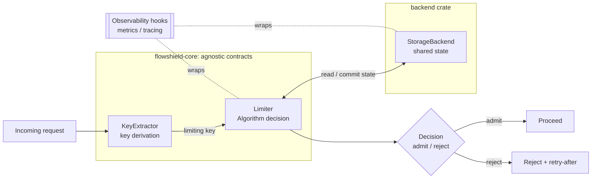

# ADR-002: Core Architecture

- **Status:** Accepted
- **Date:** 2026-07-20
- **Deciders:** FlowShield maintainers
- **Related:** ADR-001 (Vision & Scope), ADR-003 (Crate Structure), ADR-005 (Storage Abstraction), ADR-008 (Algorithms), ADR-012 (Observability), ADR-016 (Async Runtime Strategy); FR-ratelimit-core, NFR-portability, NFR-observability

## Context

FlowShield must let one core express many combinations of *who is limited*, *by what rule*, and *against what shared state*, across multiple storage engines and web frameworks (ADR-001). To keep the core reusable and the integrations swappable, the request-evaluation pipeline needs a clear internal layering with stable seams, and a deliberate decision about where asynchrony begins and where side-effects (I/O, metrics) are allowed.

The design must also make room for the broader traffic-management roadmap without reshaping these seams later.

## Decision

FlowShield's evaluation core is organized as three cooperating responsibilities behind stable extension points:

1. **Key derivation (KeyExtractor).** Turns request/ambient context into a limiting key (e.g., tenant, IP, route, composite). Pure and synchronous where possible; framework-specific extraction lives in integration crates, not the core.
2. **Algorithm decision (Algorithm).** Given a key and the current/committed state, decides *admit / reject* and produces decision metadata (remaining, retry-after, reset). Token Bucket and GCRA are the v1 families (ADR-008). Algorithms are storage-neutral — they describe *what* state transition is needed, not *how* it is persisted.
3. **Storage state (StorageBackend).** Reads and commits the algorithm's state atomically enough to honor the backend's consistency contract (ADR-005, ADR-006). Memory is exact; Redis/Valkey are exact on the executing primary, with bounded over-admission only under replication/failover (ADR-005).

**Separation boundaries.**
- The **core crate** owns the three contracts and their orchestration; it depends on no storage engine and no framework.
- **Backends** implement StorageBackend; **integrations** implement KeyExtractor/Middleware for a given framework. Dependencies point *inward* to the core, never outward (ADR-003).

**Async decision boundary.** Key derivation and the algorithm's decision logic are designed to be synchronous and side-effect-free; **asynchrony is introduced at the StorageBackend seam**, where network I/O may occur. Tokio is the primary runtime, and the core stays runtime-independent as far as is practical (ADR-016). This keeps the "pure" decision core testable and portable, and confines `.await` points to the storage interaction.

**Observability hooks** live at the orchestration layer, wrapping the decision and the storage interaction, so metrics/tracing (ADR-012) capture outcome, latency, and backend health uniformly regardless of which algorithm or backend is plugged in. Hooks are inert unless the `metrics`/`tracing` features are enabled.

## Alternatives Considered

- **Monolithic limiter (algorithm + storage fused).** One type per algorithm+backend pairing. *Rejected:* combinatorial explosion (algorithms × backends), no reuse of decision logic, and every new backend re-implements every algorithm.
- **Async-everywhere core.** Make key derivation and decision logic async too. *Rejected:* forces a runtime dependency into pure logic, complicates testing, and adds `.await` overhead where no I/O occurs; the only genuine async work is storage I/O.
- **Storage-aware algorithms.** Let algorithms issue backend-specific commands directly (e.g., embed Lua). *Rejected:* couples algorithm code to a storage engine, breaking the agnostic core and preventing an algorithm from working across memory and Redis alike.
- **Observability inside each backend/algorithm.** *Rejected:* inconsistent, duplicated instrumentation; centralizing at orchestration gives uniform, comparable signals.

## Consequences

**Positive**
- Algorithms and backends compose freely (N + M implementations, not N × M).
- Pure, synchronous decision core is easy to test and reason about.
- Async and I/O are confined to one seam, easing runtime-independence goals.
- Uniform observability across all combinations.

**Negative**
- The read-then-commit split across the storage seam requires careful contract design to preserve atomicity guarantees under distribution.
- The extra indirection of three contracts adds conceptual overhead versus a single fused type.

**Neutral**
- Framework specifics are pushed entirely to integration crates.
- The same three-layer shape is intended to carry future decision families (concurrency, quotas, throttling, budgeting).

## Future Evolution

Additional traffic-management modes become new Algorithm/decision families reusing the same KeyExtractor and StorageBackend seams. Batched or pipelined storage interactions, and optional local pre-check caches in front of distributed backends, can be added at the storage seam without changing the core contracts. The stability guarantees for all four extension points are set by ADR-013.
