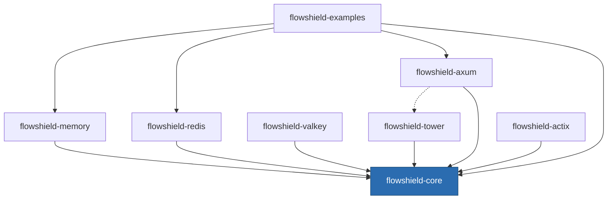

# ADR-003: Crate Structure

- **Status:** Accepted
- **Date:** 2026-07-20
- **Deciders:** FlowShield maintainers
- **Related:** ADR-002 (Core Architecture), ADR-005 (Storage Abstraction), ADR-009 (Middleware & Framework Integration), ADR-010 (Feature Flags), ADR-013 (Public Extension API Stability); NFR-footprint, NFR-portability, NFR-compile-time

## Context

FlowShield's architecture separates an agnostic core from swappable backends and per-framework integrations (ADR-002). That separation must be expressed physically in the Cargo workspace so dependency direction is enforced by the compiler, so users pay in compile time and binary footprint only for what they use, and so a bug or breaking change in one framework integration cannot ripple into unrelated ones.

The workspace is edition 2024, targets Rust >= 1.88 (no committed MSRV until pre-1.0, ADR-015), and is dual-licensed MIT OR Apache-2.0. All crates share the `flowshield-` prefix.

## Decision

FlowShield is a **multi-crate Cargo workspace** with a strict inward dependency rule: **integrations and backends depend on core; core depends on neither.**

Planned crates:

- **flowshield-core** — the agnostic contracts and orchestration (KeyExtractor, Algorithm, StorageBackend, Middleware traits; decision types; error model). Storage- and framework-agnostic.
- **flowshield-memory** — in-process, exact-semantics StorageBackend.
- **flowshield-redis** — Redis StorageBackend (exact on the executing primary; bounded over-admission only under replication/failover — see ADR-005).
- **flowshield-valkey** — Valkey StorageBackend, first-class alongside Redis (ADR-006).
- **flowshield-tower** — Tower `Service`/layer integration.
- **flowshield-axum** — Axum integration.
- **flowshield-actix** — Actix Web integration.
- **flowshield-examples** — runnable examples; depends on others, depended on by none.

**Naming.** Every crate uses the `flowshield-` prefix for namespace clarity and discoverability on crates.io.

**Dependency direction rules.**
- Core is a leaf toward the rest of the ecosystem: it never imports a backend or a framework crate.
- Backends depend only on core (plus their storage client).
- Framework integrations depend on core and typically on a backend chosen by the user; framework crates never depend on each other.
- Feature flags (ADR-010) gate optional backends/integrations behind the umbrella; `default = ["memory"]`.

**Per-framework isolation.** Each web framework gets its own crate rather than feature-gated modules in one integration crate. This prevents one framework's dependency tree, version churn, or breaking change from forcing recompiles or version bumps on users of another.

*(Dashed edge = optional/likely-but-not-mandatory dependency; user code selects a backend for an integration.)*

## Alternatives Considered

- **Single mega-crate with feature flags for everything.** *Rejected:* every dependency (Redis client, Axum, Actix) enters one dependency graph; feature unification and slow compiles hurt everyone, and a breaking change anywhere forces a version bump for all users. Poor footprint isolation.
- **Core + one "integrations" crate + one "backends" crate.** *Rejected:* coarser than needed; still couples unrelated frameworks/backends into shared compilation units and version lifecycles.
- **No shared prefix / vanity crate names.** *Rejected:* harms discoverability and namespace hygiene on crates.io; `flowshield-` makes the ecosystem legible.
- **Framework crates depending on each other freely.** *Rejected:* creates hidden coupling; only a deliberate, documented edge (e.g., Axum building on Tower) is allowed.

## Consequences

**Positive**
- Compiler-enforced dependency direction keeps the core truly agnostic (ADR-002).
- Users compile and ship only the backends/frameworks they enable — minimal footprint and faster builds.
- A breaking change in one framework integration is contained to that crate's version line.
- Clear, prefixed crate names aid discovery and mental mapping.

**Negative**
- More crates to version, release, and document; cross-crate changes require coordinated releases.
- Contributors must understand the workspace layout and dependency rules before adding code.

**Neutral**
- Some duplication of glue/boilerplate across framework crates is accepted in exchange for isolation.
- Feature-flag policy (ADR-010) governs how optional crates are surfaced to users.

## Future Evolution

New backends and framework integrations arrive as additional `flowshield-*` crates following the same inward dependency rule, with no change to core. Future traffic-management modes (concurrency, quotas, throttling, budgeting) extend flowshield-core's contracts rather than adding new dependency edges. If an umbrella/facade crate is ever introduced for ergonomics, it must sit at the top of the graph (depending inward) and never invert the direction rule. Extension-point stability across these crates is governed by ADR-013.
