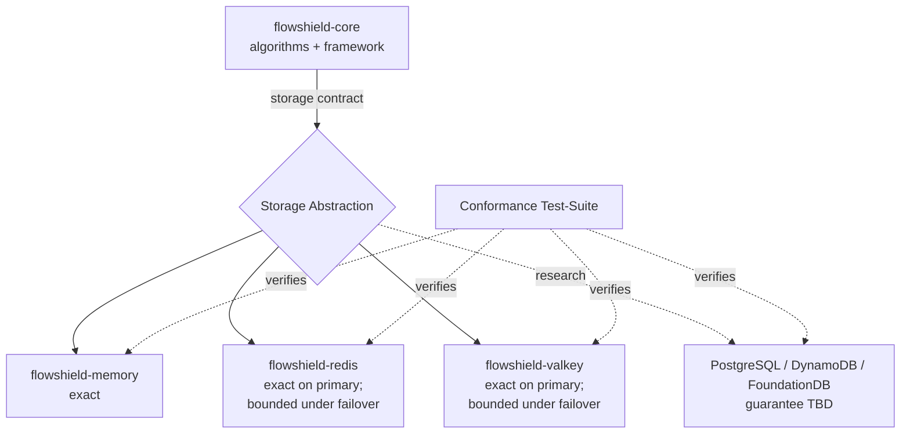

# ADR-005: Storage Abstraction

- **Status: Accepted**
- **Date: 2026-07-20**
- **Deciders: FlowShield maintainers**
- **Related:** ADR-002 (Core Architecture), ADR-004 (Public API), ADR-006 (Redis & Valkey Strategy), ADR-007 (Backend Degradation Policy), ADR-008 (Algorithms), ADR-013 (Extension API Stability), ADR-017 (Time Source); FR-024, FR-025, NFR-002, NFR-020

## Context

FlowShield is storage-agnostic by design: `flowshield-core` defines the framework and rate-limiting algorithms, while concrete state lives in pluggable backends (`flowshield-memory`, `flowshield-redis`, `flowshield-valkey`, and future research backends such as PostgreSQL, DynamoDB, and FoundationDB). For this to hold, the core must depend on a single, minimal storage contract rather than on any backend's capabilities.

The central difficulty is that a rate-limiting decision is inherently a **read-modify-write** on per-key state (bucket level, theoretical arrival time, timestamps). If that cycle is not atomic, concurrent requests race and admit more traffic than the limit permits. Backends differ radically in how — and whether — they can make this atomic: an in-process backend can hold a lock or use atomic cells, whereas a networked store must push atomicity to the server. The abstraction must therefore specify *required semantics* without dictating *implementation*, and must be honest that different backends deliver different consistency guarantees. Papering over that difference with a single "one-size" guarantee would either understate the memory backend's exactness or overstate the distributed backends' precision.

## Decision

FlowShield defines a **storage abstraction** as the sole contract between core algorithms and backends. Every conforming backend MUST provide, at the design level:

1. **Atomic check-and-consume.** A single logical operation that, given a key, an algorithm parameterization, and a request cost, evaluates the limit and conditionally mutates state — with no observable interleaving against concurrent operations on the same key. How atomicity is achieved is the backend's concern (in-process synchronization for memory; server-side atomic scripting for RESP backends, see ADR-006).
2. **Per-key state.** Isolated, independently addressable state per limiter key, with no cross-key interference.
3. **Expiry / TTL.** Idle keys must be reclaimable so unbounded key spaces do not leak memory. Backends expose a bounded, documented staleness/retention behavior; expiry must never resurrect a limit as more permissive than intended.
4. **Error, timeout, and unavailability reporting.** Operations must surface a typed outcome distinguishing *allowed*, *denied*, and *backend failure* (timeout, connection loss, transient error). The core never silently treats a failure as an allow or deny; the policy for that lives in ADR-007.
5. **Declared consistency guarantee.** Each backend advertises its guarantee as part of its public identity, so the guarantee is visible to users rather than hidden.

Consistency is documented **per backend**, and we deliberately separate two layers that are often conflated:

- **Node-level operation semantics** — what a single atomic check-and-consume guarantees on the node that executes it.
- **Deployment-topology behavior** — what replication, clustering, and failover add on top of that.

Redis and Valkey are **not** "eventually consistent" as stores. An atomic check-and-consume executed on a primary (e.g., via server-side scripting, ADR-006) is atomic and **exact on that node**. Eventual consistency is a property of specific *deployment topologies* — reading from a replica, cluster resharding, or failover to a lagging replica — not an intrinsic property of the store. The abstraction states both layers so users can reason about the one that matches their deployment.

| Backend | Node-level operation semantics | Deployment-topology behavior | Over-admission bound |
|---|---|---|---|
| flowshield-memory | Exact, linearizable (single process) | N/A — state is not shared across nodes | None (authoritative in-process) |
| flowshield-redis | Atomic & **exact on the executing primary** (server-side atomic check-and-consume, ADR-006) | Single primary: exact overall. Replication / cluster / failover can expose a bounded staleness window when a decision is served against not-yet-propagated state | Zero in single-primary steady state; bounded, documented worst case during replica lag or failover |
| flowshield-valkey | Same as Redis (shared RESP logic, ADR-006) | Same as Redis | Same as Redis |
| PostgreSQL | **Research candidate — guarantee TBD** | TBD during backend design | TBD |
| DynamoDB | **Research candidate — guarantee TBD** | TBD during backend design | TBD |
| FoundationDB | **Research candidate — guarantee TBD** | TBD during backend design | TBD |

The public API **exposes** each backend's guarantee rather than forcing identical semantics (ADR-004). A user on the memory backend gets in-process exactness; a user on Redis or Valkey gets operations that are exact on the executing primary — and, in a single-primary deployment, exact overall — with a stated, bounded worst-case over-admission that can arise **only** from replication/failover topologies, which they can reason about explicitly. Research-candidate backends are intentionally left unspecified: assigning a consistency guarantee before the backend is designed would be speculative, so their guarantees are marked TBD and fixed when each is designed.

A **backend conformance test-suite** is defined as a reusable, backend-independent specification of behaviors every backend must satisfy: atomicity under concurrency (no over-admission beyond the backend's declared bound), correct expiry, correct denial at capacity, monotonic replenishment, faithful error/timeout signaling, and **deterministic logical behavior**. The determinism requirement is explicit: *given identical inputs and conditions, every conforming backend must produce identical logical rate-limiting decisions within its documented consistency guarantee.* Concretely, against an **exact** backend the decision sequence for a fixed input trace is fully determined and must match a reference oracle exactly; against a **bounded-staleness** backend, decisions must match that reference within the declared over-admission bound. Deterministic evaluation requires a controllable, injectable time source (ADR-017) so that "identical conditions" — including the passage of time — can actually be reproduced in tests. New backends — including the research-candidate stores — prove membership by passing this suite. Its stability as an extension point is governed by ADR-013.

## Alternatives Considered

- **Single universal consistency guarantee for all backends.** Rejected: it would force the memory backend to advertise weaker-than-real semantics or force distributed backends to claim exactness they cannot deliver without prohibitive coordination cost. Dishonest guarantees are worse than none.
- **Backend-specific APIs (no shared abstraction).** Rejected: it would couple algorithms to each store, prevent backend swapping, duplicate algorithm logic per backend, and make the conformance suite impossible.
- **Push atomicity into the core via a distributed lock in front of any backend.** Rejected: a generic distributed lock adds a round trip and a second failure domain, and still cannot beat a server-side atomic operation for correctness or latency. Atomicity belongs where the state lives.
- **Client-side read-then-write with optimistic retry as the contract.** Rejected as the *required* mechanism: it multiplies round trips under contention and leaks store-specific concurrency control into core. It remains a permissible internal backend strategy, not a mandated contract.

## Consequences

**Positive**
- One narrow contract keeps core genuinely storage-agnostic and testable in isolation.
- Honest per-backend guarantees let users make informed correctness/latency trade-offs.
- The conformance suite gives new backends an objective bar and protects against silent regressions.

**Negative**
- Users must understand that guarantees differ by backend; documentation burden is real.
- The contract must be conservative (least-common-denominator) to remain implementable by simple stores, which can leave advanced backend features unexposed through the core path.

**Neutral**
- Backends may offer capabilities beyond the contract through their own crates, provided the core path stays within the abstraction.
- The over-admission bound becomes a first-class, documented property rather than an accident.

## Future Evolution

Research-candidate backends (PostgreSQL, DynamoDB, FoundationDB) can join once designed by advertising whatever guarantee they are actually built to provide — the abstraction already admits stronger-than-required semantics, so a strongly-consistent store fits the same contract without changing it. Guarantees are assigned when each backend is designed, never presumed beforehand. If future algorithms (ADR-008) need richer primitives (e.g., atomic multi-key operations), the contract may gain optional, capability-gated extensions, added compatibly under ADR-013 so existing backends remain conformant.
