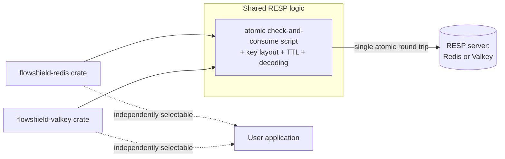

# ADR-006: Redis & Valkey Strategy

- **Status: Accepted**
- **Date: 2026-07-20**
- **Deciders: FlowShield maintainers**
- **Related:** ADR-004 (Public API), ADR-005 (Storage Abstraction), ADR-007 (Backend Degradation Policy), ADR-010 (Feature Flags), ADR-012 (Observability), ADR-013 (Extension API Stability); FR-021, FR-022, NFR-001, NFR-002

## Context

FlowShield ships two distributed backends in v1: `flowshield-redis` and `flowshield-valkey`. Both must be **first-class** (not one favored, one an afterthought) and **vendor-neutral** — FlowShield takes no side in the Redis/Valkey licensing split and must not bind users to either vendor.

Today Redis and Valkey are **RESP-compatible**: Valkey originated as a Redis fork and speaks the same wire protocol and command semantics relevant to rate limiting, including server-side atomic scripting. This creates an opportunity — one backend implementation could serve both — and a risk — the two projects may diverge over time, so the design must not weld them permanently together.

Both backends implement the storage abstraction from ADR-005, which requires an atomic check-and-consume and a declared consistency guarantee. Because these stores are networked and typically replicated, an atomic check-and-consume is exact on the executing primary, while replication and failover can introduce a bounded, documented over-admission. (The eventual consistency here is a property of the deployment topology, not of the store itself — see ADR-005.) The strategy must specify how atomicity, connection management, timeouts, and that bound are handled at the design level.

## Decision

**Shared RESP-based implementation, separately packaged.** The rate-limiting logic for RESP stores — the atomic check-and-consume script, key layout, TTL handling, and result decoding — is defined once as shared logic and reused by both backends. `flowshield-redis` and `flowshield-valkey` remain **separate crates** (and/or feature flags per ADR-010) with distinct public identities, so each is independently selectable and can **diverge later** without breaking the other. Users never depend on both to get one.

**Server-side atomicity (requirement).** The check-and-update MUST execute atomically on the server, via the store's atomic scripting facility, so that evaluating the limit and mutating per-key state is a single indivisible unit. Client-side read-then-write is prohibited as the correctness mechanism because it races under concurrency and adds round trips. This satisfies ADR-005's atomic check-and-consume requirement for networked stores.

**Vendor neutrality.** Shared logic restricts itself to the RESP-compatible common subset. Neither backend's public surface presents itself as the "primary." Documentation, naming, and defaults treat the two symmetrically. Any future vendor-specific capability is confined to that vendor's crate and does not leak into shared logic.

**Connection, pooling, and timeouts (design level).** Both backends are designed around a managed connection pool with bounded acquisition, per-operation timeouts, and configurable retry, so a slow or unreachable store degrades predictably rather than blocking callers unboundedly. Every operation resolves to allowed, denied, or a typed backend-failure outcome; what happens on failure (fail-open, fail-closed, fallback) is governed by ADR-007, and operational signals are emitted per ADR-012. On the hot path, exactly one atomic server round trip per decision is the target (NFR-001).

**Bounded over-admission rationale.** Under replication and failover, a decision may be evaluated against slightly stale state (e.g., a replica promoted before the latest write propagated, or brief split-brain during failover). This can admit marginally more traffic than the nominal limit. The strategy accepts this as a **bounded, documented over-admission arising from deployment topology (replication/failover)** — not from any non-atomicity of the operation, which remains exact on the executing primary: the worst case is proportional to in-flight/unpropagated state at the moment of a topology change, not unbounded, and returns to nominal once the cluster reconverges. This bound is stated in user-facing docs (ADR-005) so operators can size limits accordingly.

## Alternatives Considered

- **Two fully independent implementations.** Rejected: duplicates the atomic script and key logic, doubling maintenance and inviting subtle behavioral drift between backends that should behave identically today.
- **One combined `flowshield-redis-valkey` crate.** Rejected: couples the vendors permanently, obstructs future divergence, and forces users to pull in both to use one. Violates vendor neutrality and clean packaging.
- **Client-side read-modify-write with optimistic locking.** Rejected: extra round trips, worse tail latency under contention, and store-specific concurrency control in the client. Server-side atomic scripting is simpler and correct.
- **A single blessed "primary" backend with the other as a thin alias.** Rejected: incompatible with treating both as first-class and vendor-neutral.

## Consequences

**Positive**
- One correct, well-tested atomic path serves both stores; behavior stays consistent while they remain RESP-compatible.
- Separate crates/features keep the vendors independent and future-proof against divergence.
- Server-side atomicity gives correctness and a single hot-path round trip.

**Negative**
- Shared logic is constrained to the RESP common subset, so vendor-specific optimizations cannot enter the shared path.
- Two published artifacts must be kept in step for as long as they share logic, adding release coordination.

**Neutral**
- Bounded over-admission under replication/failover is an accepted, documented property, not a defect; operations remain exact on the executing primary.
- If the projects diverge, the shared layer can be split later with the public crate boundaries already in place.

## Future Evolution

If Redis and Valkey diverge in wire protocol or scripting semantics, the shared layer splits along the existing crate boundary with minimal user impact. Vendor-specific features (new atomic primitives, server-side data structures) can be adopted inside a single backend crate without disturbing the other or the ADR-005 contract, evolving compatibly under ADR-013.
