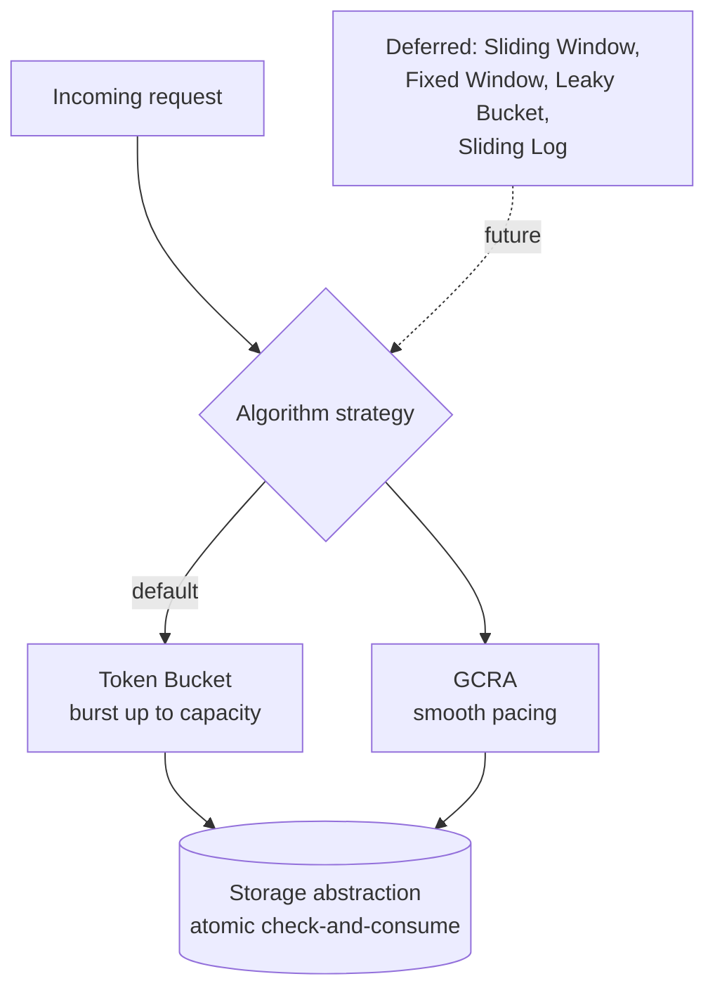

# ADR-008: Rate-Limiting Algorithms

- **Status: Accepted**
- **Date: 2026-07-20**
- **Deciders: FlowShield maintainers**
- **Related:** ADR-002 (Core Architecture), ADR-004 (Public API), ADR-005 (Storage Abstraction), ADR-013 (Extension API Stability), ADR-017 (Time Source); FR-012, FR-071, NFR-002, NFR-003

## Context

The rate-limiting algorithm decides, per request, whether traffic is admitted and how bursts and steady-state pacing behave. FlowShield needs a small, high-quality v1 set that covers the common cases well, keeps per-key state minimal (state size directly affects memory footprint and distributed cost per ADR-005), and behaves correctly across both exact backends and backends with bounded staleness under replication/failover.

There is a broad menu of classic algorithms — Token Bucket, GCRA, Sliding Window (Counter), Fixed Window, Leaky Bucket, and Sliding Log — each with different complexity, memory, burst behavior, and suitability for distributed operation. Shipping all of them in v1 would dilute focus and enlarge the surface that must stay stable under ADR-013. We instead ship two and defer the rest.

## Decision

**v1 ships Token Bucket (DEFAULT) and GCRA.** All other algorithms are **deferred**: Sliding Window, Fixed Window, Leaky Bucket, Sliding Log.

- **Token Bucket — default.** Chosen for familiarity: it is the de facto model in API gateways and cloud rate limiters, so its `rate` + `burst` mental model is immediately intuitive to most users. It permits bursts up to bucket capacity, then enforces the average refill rate. State per key is small (a token level plus a last-update timestamp). It is well-suited to distributed backends because the check-and-consume reduces to an atomic update of that small state (ADR-006).
- **GCRA (Generic Cell Rate Algorithm).** Chosen for precision and smooth pacing: it enforces a minimum inter-arrival interval, producing even spacing rather than clustered bursts, with a bounded burst tolerance. It keeps minimal state (a single theoretical-arrival-time value per key) and has proven precedent in the Rust ecosystem — most notably the widely-used [`governor`](https://crates.io/crates/governor) crate, which is built on GCRA, evidence of the algorithm's production viability in Rust. *(This is architectural context only; FlowShield does not take `governor` as an implementation dependency.)* GCRA gives users a rigorous option where smoothness matters (e.g., protecting a downstream with tight pacing requirements).

Each shipped algorithm documents four properties: **burst behavior**, **smoothing**, **memory/state per key**, and **distributed suitability**.

### Comparison

| Algorithm | v1 | Time complexity | Per-key memory | Burst handling | Smoothing | Fairness | Distributed suitability |
|---|---|---|---|---|---|---|---|
| **Token Bucket** | ✅ default | O(1) | Low (level + timestamp) | Allows bursts up to capacity, then average rate | Moderate (bursty then smooth) | Moderate — a caller may spend a full burst at once, briefly monopolizing a shared downstream | Strong — atomic update of small state |
| **GCRA** | ✅ | O(1) | Minimal (single TAT value) | Bounded burst via tolerance | High (even inter-arrival spacing) | High — enforced inter-arrival spacing prevents any caller from monopolizing via bursts | Strong — atomic update of one value |
| Sliding Window (Counter) | deferred | O(1) | Low–moderate (two window counters) | Smooths window-edge bursts vs. fixed | Moderate | Moderate — fairer than fixed at window edges | Good — small counters, atomic increment |
| Fixed Window | deferred | O(1) | Very low (one counter + window id) | Permits 2x burst at window boundaries | Low | Low — boundary double-burst lets a caller exceed its intended share at edges | Good, but boundary bursts undercut accuracy |
| Leaky Bucket (queue) | deferred | O(1) amortized | Moderate (queue/level + timestamp) | Shapes to constant output; no bursts | Very high | Very high — constant drain rate gives the most even access | Moderate — queue semantics harder to distribute |
| Sliding Log | deferred | O(n) per key (n = events in window) | High (timestamp per event) | Exact within window | High | High — exact accounting within the window | Weak — unbounded state, costly to distribute |

**On fairness — why choose GCRA over Token Bucket.** Token Bucket admits a full burst in a single instant, so one caller can momentarily consume the entire allowance and starve others contending for a shared downstream; it is fair *over time* but bursty *in the moment*. GCRA enforces a minimum spacing between admitted requests, so access is distributed evenly and no single caller can monopolize capacity through bursting. Prefer **GCRA** when protecting a sensitive shared resource where even pacing matters more than burst friendliness; keep the **Token Bucket** default when the familiar burst-tolerant behavior of gateways/cloud is what users expect.

### Justification of the v1 pair and default

Token Bucket and GCRA together are both O(1) in time and minimal in per-key state, which keeps memory and distributed round-trip cost low and makes both a natural fit for the atomic check-and-consume of ADR-005. They span the two dominant user needs: Token Bucket for an intuitive, burst-friendly default familiar from gateways and cloud, and GCRA for precise, smoothly-paced limiting. Sliding Log is deferred primarily for unbounded per-key state and O(n) cost; Fixed Window for its window-boundary burst inaccuracy; Sliding Window and Leaky Bucket are reasonable but add surface without covering a need the v1 pair leaves open. Token Bucket is the default because it is the least surprising choice for the largest audience.

## Alternatives Considered

- **Ship only Token Bucket.** Rejected: leaves users needing tight, smooth pacing without a first-class option; GCRA adds high value at minimal state cost.
- **Ship the full menu in v1.** Rejected: enlarges the stability surface (ADR-013) and maintenance burden before demand is proven; Sliding Log in particular brings unbounded per-key state.
- **Make GCRA the default.** Rejected: GCRA's model is less familiar to the typical gateway/cloud user; a surprising default harms adoption even though GCRA is more precise.
- **Fixed Window as default for simplicity.** Rejected: its window-boundary double-burst makes it the least accurate choice, a poor default for a correctness-focused framework.

## Consequences

**Positive**
- Two O(1), low-state algorithms cover the common and the precision cases while keeping memory and distributed cost low.
- A familiar default lowers the adoption barrier; GCRA gives a rigorous alternative.
- Small v1 set keeps the algorithm extension surface (ADR-013) tight and well-tested.

**Negative**
- Users needing exact-window or shaping-queue semantics must wait for deferred algorithms or supply their own.
- Two algorithms mean two behavior contracts to document and conformance-test across every backend.

**Neutral**
- Algorithm selection is a strategy choice orthogonal to backend choice; both compose through the ADR-005 contract.
- Deferred algorithms are documented now so users can plan around the roadmap.

## Future Evolution

Deferred algorithms (Sliding Window, Fixed Window, Leaky Bucket, Sliding Log) can be added as additional strategies behind the stable algorithm extension point (ADR-013) without changing the storage contract, provided each stays within the per-key state and atomicity envelope of ADR-005. Adaptive throttling and concurrency-limiting strategies, part of FlowShield's longer roadmap, will be introduced as new strategy families under the same extension rules.
