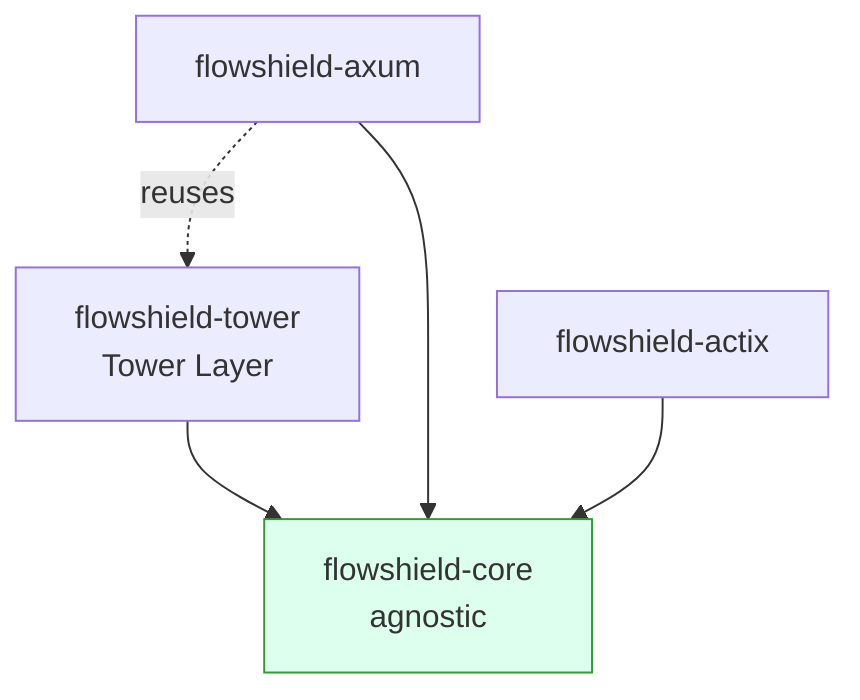
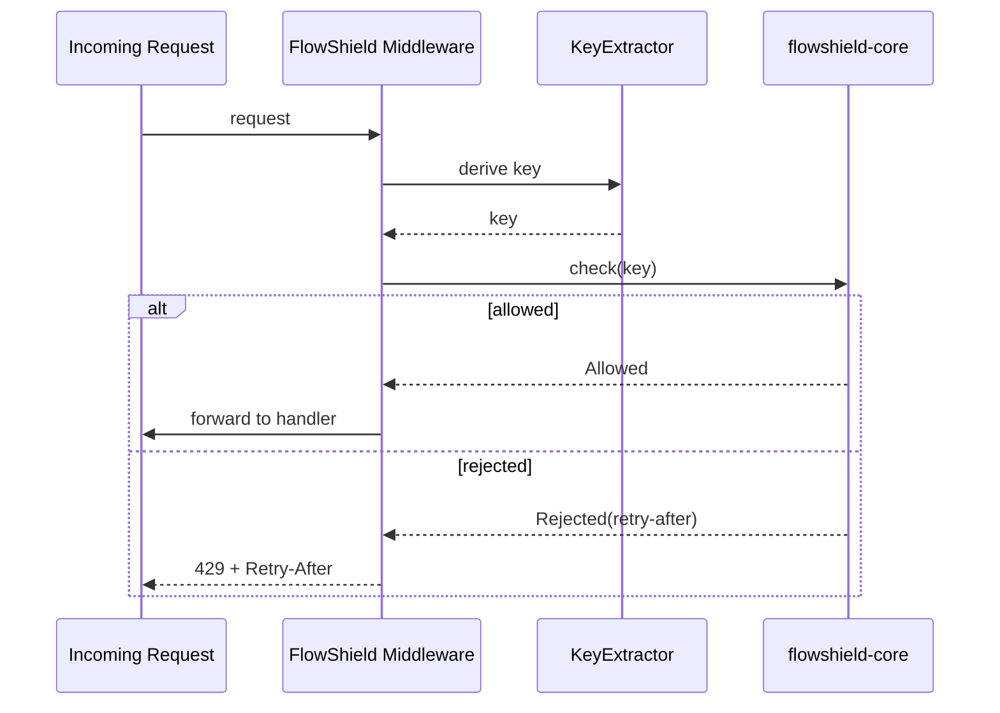

# ADR-009: Middleware & Framework Integration Strategy

- **Status: Accepted**
- **Date: 2026-07-20**
- **Deciders: FlowShield maintainers**
- **Related:** ADR-002 (Core Architecture), ADR-003 (Crate Structure), ADR-004 (Public API), ADR-013 (Extension API Stability), ADR-016 (Async Runtime); FR-030, FR-031, FR-032, FR-033, FR-034, FR-011, NFR-021

## Context

FlowShield must be usable from mainstream Rust web stacks without dragging web-framework concerns into its storage- and framework-agnostic core (ADR-002). The Rust HTTP ecosystem is split between the `tower`/`hyper` lineage (which Axum builds on) and the independent Actix Web stack. These frameworks evolve on their own release cadences and occasionally publish breaking major versions. If integration code lived in the core crate, every downstream framework bump would risk churning `flowshield-core` and its dependents.

We need an integration strategy that: (1) reaches the largest slice of the ecosystem in v1; (2) isolates each framework's version churn; (3) keeps the dependency direction strictly one-way (integrations depend on core, never the reverse, per ADR-003); and (4) produces correct HTTP semantics — most importantly a well-formed `429 Too Many Requests` with retry metadata — while letting applications decide *what* to rate-limit on.

## Decision

v1 ships three integrations, each as an independent crate:

- **`flowshield-tower`** — the foundational integration, expressed as a Tower middleware layer. This is the primary, most reusable surface for the `tower`/`hyper` world.
- **`flowshield-axum`** — builds on the Tower integration where practical, adding Axum-idiomatic ergonomics (extractors, typed responses) rather than reimplementing the limiter plumbing.
- **`flowshield-actix`** — a standalone integration for Actix Web, which does not share Tower's middleware model and therefore carries its own transport-specific glue.

Cross-cutting rules:

- **Dependency direction is one-way.** Every integration depends on `flowshield-core`; core has no knowledge of any web framework. This preserves core's agnosticism and its extension-API stability guarantees (ADR-013).
- **One crate per framework, mutually independent.** No integration depends on another except the deliberate, practical reuse of `flowshield-tower` by `flowshield-axum`. A breaking release in Actix cannot force a change in the Axum or Tower crates.
- **Applications supply a `KeyExtractor` strategy.** The integration layer derives the rate-limit key from the request via an application-provided strategy, with a sensible default (e.g. client address). This keeps policy — per-IP, per-API-key, per-tenant, per-route — in application hands, not baked into the middleware.
- **Rejections carry retry-after metadata.** A limiter decision of "rejected" (a normal outcome, not an error — see ADR-011) must surface the retry-after hint so the integration can emit a correct `429 Too Many Requests` with a `Retry-After` header. Allowed requests pass through untouched apart from optional informational headers.

### Request flow (per integration)

## Alternatives Considered

- **Single "mega" integration crate with feature-gated frameworks.** Rejected: it couples unrelated frameworks in one dependency graph, enlarges the feature/test matrix (ADR-010), and lets one framework's breaking change block releases for users of the others. Separate crates isolate churn cleanly.
- **Integration logic inside `flowshield-core`.** Rejected: violates the one-way dependency rule (ADR-003), pollutes the agnostic core with HTTP types, and undermines the extension-API stability contract (ADR-013).
- **Actix on top of Tower.** Rejected as impractical for v1: Actix Web does not use Tower's `Service`/`Layer` model, so a shim would add complexity and a leaky abstraction for little gain. A native Actix integration is clearer.
- **Framework-owned key policy (fixed per-IP keying).** Rejected: real deployments key on API keys, tenants, or routes. A pluggable `KeyExtractor` with an address default is strictly more capable at negligible cost.

## Consequences

**Positive**
- Web-framework churn is quarantined per crate; core stays stable and agnostic.
- Broad ecosystem coverage in v1 (Tower + Axum + Actix) with minimal duplication.
- Correct, standards-aligned `429` responses with `Retry-After`, out of the box.
- Applications retain full control over rate-limit keying.

**Negative**
- Three integration crates to version, document, and test.
- The Axum-reuses-Tower relationship must be maintained as both evolve.

**Neutral**
- Additional frameworks become new crates rather than changes to existing ones.
- Integration crates track their framework's supported version range independently.

## Future Evolution

- Add further integrations (e.g. `hyper`-direct, gRPC/`tonic`, other frameworks) as new isolated crates without touching core.
- Optionally expose richer response shaping (rate-limit informational headers, structured problem responses) behind opt-in configuration.
- Revisit whether an Actix-over-Tower bridge becomes worthwhile if the Actix ecosystem converges on Tower primitives.
