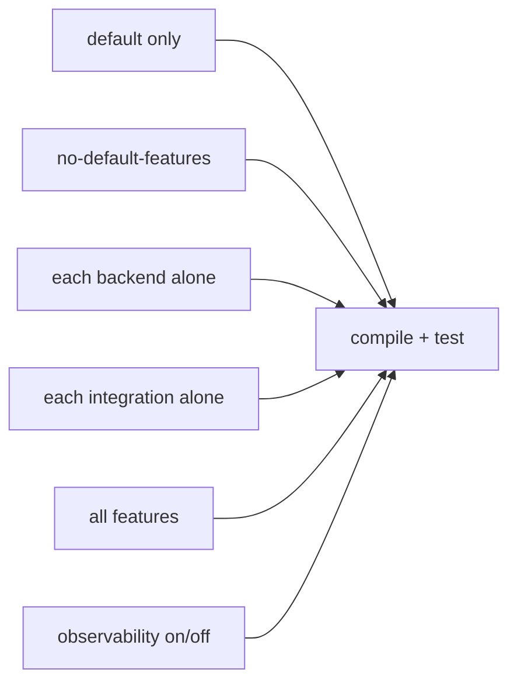

# ADR-010: Feature Flag Strategy

- **Status: Accepted**
- **Date: 2026-07-20**
- **Deciders: FlowShield maintainers**
- **Related:** ADR-003 (Crate Structure), ADR-009 (Middleware & Integration), ADR-012 (Observability); FR-003, NFR-023, NFR-033

## Context

Cargo features are powerful but easy to abuse. A large or non-additive flag set produces a combinatorial explosion of build configurations, each of which must in principle compile and be tested. Non-additive or mutually exclusive features break Cargo's feature-unification model and cause surprising failures when crates are combined in a dependency graph. FlowShield spans multiple storage backends, three framework integrations (ADR-009), and cross-cutting observability, so a disciplined flag policy is essential to keep the CI matrix and maintenance burden bounded.

Two requirements shape the design: features must be **additive** (enabling more never removes or changes behavior), and observability (`metrics`, `tracing`) must be **off by default** with **negligible overhead when disabled** (ADR-012).

## Decision

Keep the feature set **minimal**. The default enables only in-memory storage:

`default = ["memory"]`

| Flag       | Default | Enables                                             | Notes |
|------------|:-------:|-----------------------------------------------------|-------|
| `memory`   |   on    | In-memory storage backend (`flowshield-memory`)     | Zero external deps; the default backend |
| `redis`    |   off   | Redis distributed backend (`flowshield-redis`)      | Additive; does not pull other backends |
| `valkey`   |   off   | Valkey distributed backend (`flowshield-valkey`)    | Additive; independent of `redis` |
| `tower`    |   off   | Tower middleware integration                        | Foundational integration (ADR-009) |
| `axum`     |   off   | Axum integration                                    | Builds on Tower where practical |
| `actix`    |   off   | Actix Web integration                               | Standalone integration |
| `metrics`  |   off   | Metrics emission                                    | Negligible overhead when disabled (ADR-012) |
| `tracing`  |   off   | Structured tracing/spans                            | Negligible overhead when disabled (ADR-012) |

Discipline rules:

- **Additive only.** Enabling any flag adds capability and never alters or removes existing behavior. There are no mutually exclusive features.
- **No transitive backend/integration bleed.** Enabling one backend (or one integration) must not compile in another. `redis` never drags in `valkey`; `axum` never forces `actix`.
- **Observability opt-in and zero-cost when off.** With `metrics`/`tracing` disabled, instrumentation compiles away to negligible overhead; no runtime cost is paid by users who do not opt in.
- **Minimal surface.** New flags require justification against the matrix cost below; convenience flags are avoided.

### CI feature-combination matrix

Because features are additive and independent, CI does not need the full power set. It verifies:

- `--no-default-features` (bare core) must build.
- `default` must build and test.
- Each backend and each integration enabled **in isolation** must build — proving no cross-bleed.
- `--all-features` must build and test.
- `metrics`/`tracing` toggled to confirm no behavioral change and no leaked cost.

This bounded set catches the realistic failure modes (missing `cfg` guards, accidental cross-feature coupling, non-additivity) without an exponential job count.

## Alternatives Considered

- **Fine-grained flags per algorithm/option.** Rejected: multiplies the matrix, fragments documentation, and invites non-additive combinations for marginal binary-size wins.
- **All backends/integrations on by default.** Rejected: forces heavy external dependencies (Redis/Valkey clients, web frameworks) on every user and slows builds; contradicts a lean default.
- **Mutually exclusive backend flags.** Rejected: breaks Cargo feature unification — a transitive dependency enabling a second backend would fail the build unexpectedly. Additivity is non-negotiable.
- **`metrics`/`tracing` on by default.** Rejected: imposes overhead and dependencies on users who never observe; opt-in with zero-cost-when-off is strictly better (ADR-012).

## Consequences

**Positive**
- Small, comprehensible flag set; low cognitive and maintenance load.
- Bounded CI matrix — near-linear in the number of flags, not exponential.
- Additivity guarantees safe composition across arbitrary dependency graphs.
- Lean default; users pay only for what they enable.

**Negative**
- Coarser granularity: users cannot trim sub-features within a backend/integration.
- Every new capability must be weighed against matrix and maintenance cost.

**Neutral**
- Backend and integration selection is largely expressed through the separate crates of ADR-003; flags gate their inclusion.
- Some niche size optimizations are deferred in favor of simplicity.

## Future Evolution

- Introduce new flags only with a clear additive contract and matrix-cost justification.
- If binary size becomes a pressure point, consider narrowly-scoped additive sub-flags with explicit CI coverage.
- Reassess defaults if usage data shows a different backend is the common baseline.
- Automate matrix generation (e.g. a feature-powerset lint in CI) if the flag count grows.
