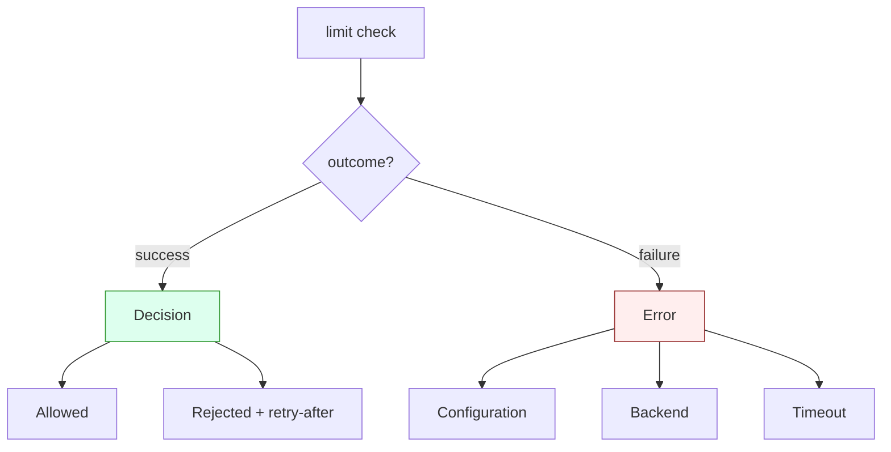

# ADR-011: Error Handling Strategy

- **Status: Accepted**
- **Date: 2026-07-20**
- **Deciders: FlowShield maintainers**
- **Related:** ADR-002 (Core Architecture), ADR-004 (Public API), ADR-007 (Degradation Policy), ADR-009 (Middleware & Integration); FR-080, FR-072, FR-001, NFR-012

## Context

A rate limiter sits on the hot path of request handling and often talks to fallible external systems (Redis, Valkey, the network). Two categories of "things go wrong" must never be conflated:

1. **A request is rejected by the limit.** This is a *normal, expected decision* — the limiter did its job and said "no". It is not a failure.
2. **The limiter operation failed.** A backend was unreachable, a call timed out, or the limiter was misconfigured. Here no valid decision could be produced.

If these are represented ambiguously, callers write incorrect degradation logic (ADR-007) — e.g. treating a backend outage as a rejection (silently denying traffic) or a rejection as an error (retval mishandling, wrong HTTP status). Additionally, on the hot path, panics are unacceptable: a recoverable condition must never unwind or abort a caller's task.

## Decision

- **No panics on recoverable failures.** Backend errors, timeouts, and configuration errors are reported as explicit, categorized, recoverable errors — never panics, aborts, or unwraps. Panics are reserved solely for genuine, unrecoverable internal invariants (bugs), never for conditions the environment can produce.
- **"Rejected" is a decision, not an error.** The outcome of a limit check is a decision value with two distinct successful cases — *allowed* and *rejected* (the latter carrying retry-after metadata for HTTP 429, per ADR-009). A rejected request is returned as a normal result. Operation *failure* is a separate, explicitly-typed error channel. The two are unambiguously distinct in the public API (ADR-004).
- **Categorized error taxonomy.** Operation failures are classified so callers can branch on cause without string-matching:

  | Category      | Meaning                                                        | Typical caller response |
  |---------------|---------------------------------------------------------------|-------------------------|
  | Configuration | Invalid/inconsistent setup detected at construction time      | Fail fast; fix and redeploy |
  | Backend       | Storage backend returned an error or was unreachable          | Apply degradation policy (ADR-007) |
  | Timeout       | An operation exceeded its deadline                            | Apply degradation policy (ADR-007) |

- **Validate configuration at construction time.** Configuration is checked when a limiter/backend is built, not lazily on first use. Invalid configuration yields an actionable error naming the offending setting and the constraint violated — never a deferred panic or a silent misbehavior.

The key structural point: **Decision** (allowed/rejected) and **Error** (config/backend/timeout) are separate outcomes. Rejection lives entirely on the success side.

## Alternatives Considered

- **Model rejection as an error.** Rejected: conflates a normal decision with failure, forces callers to inspect error contents to distinguish "denied" from "broke", and makes degradation policy (ADR-007) fragile. Rejection must be a first-class success outcome.
- **A single opaque/string error type.** Rejected: prevents callers from branching on cause (backend vs. config vs. timeout), which is exactly what degradation and alerting need. Categorization is required.
- **Panic on backend/timeout failures.** Rejected: unacceptable on the hot path; a transient outage must not crash a caller's task. These are recoverable and must be typed errors.
- **Lazy (first-use) configuration validation.** Rejected: surfaces misconfiguration late, unpredictably, and possibly in production traffic. Construction-time validation fails fast with actionable messages.

## Consequences

**Positive**
- Callers can implement correct, cause-aware degradation (ADR-007) — e.g. fail-open vs. fail-closed per category.
- No hot-path panics; robust behavior under backend turbulence.
- Misconfiguration is caught early with actionable diagnostics.
- The allowed/rejected/error trichotomy is unambiguous in the public API (ADR-004).

**Negative**
- Callers must handle a richer outcome space (decision vs. categorized error) rather than a single boolean.
- The error taxonomy is a public contract and must evolve compatibly (additively).

**Neutral**
- Integration layers (ADR-009) map rejection to `429` and operation errors to their own handling/degradation path.
- Error categories may gain finer sub-detail over time without changing the top-level split.

## Future Evolution

- Extend the taxonomy with additional recoverable categories (e.g. serialization, capacity) additively as backends grow.
- Attach richer structured context (backend identity, elapsed time, offending key) to errors behind observability flags (ADR-012).
- Provide typed configuration-error detail enabling machine-readable validation reports.
- Keep the decision/error boundary invariant across all future backends and integrations.
