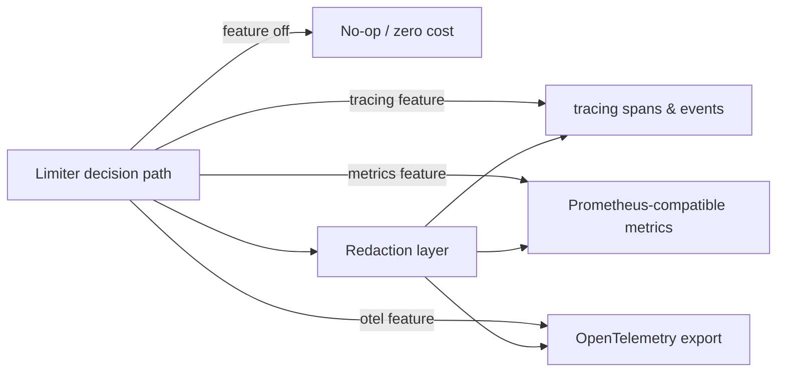

# ADR-012: Observability

- **Status:** Accepted
- **Date: 2026-07-20**
- **Deciders: FlowShield maintainers**
- **Related:** ADR-010 (Feature Flags), ADR-011 (Error Handling), ADR-007 (Degradation Policy), ADR-005 (Storage Abstraction); FR-050, FR-051, FR-052, FR-073, NFR-023

## Context

FlowShield is a distributed rate-limiting framework that sits on a request's hot path. Operators need to answer questions such as: How many requests are being allowed versus rejected? Which backend is slow? Is the limiter degrading to a fallback because a store is unreachable? Without first-class observability, a rate limiter becomes a silent, opaque gate that is impossible to tune or trust in production.

At the same time, FlowShield targets latency-sensitive deployments. Any telemetry that is always compiled in and always active would tax the very path it measures. Observability must therefore be opt-in and impose negligible cost when disabled. FlowShield also handles rate-limit keys that frequently embed sensitive identifiers (API tokens, user IDs, IP addresses); telemetry must never become a side channel that leaks this material into logs or metric labels.

The Rust ecosystem has converged on a small set of de facto standards. Adopting them — rather than inventing bespoke instrumentation — maximizes interoperability with the tooling operators already run.

## Decision

FlowShield integrates with the standard Rust observability ecosystem across three pillars:

1. **Structured logging and spans** via the `tracing` ecosystem. FlowShield emits events and spans; it does not configure a subscriber or dictate output format, leaving collection and routing to the host application.
2. **Metrics** exposed in a Prometheus-compatible model (counters, gauges, histograms) so that any Prometheus-scrape or compatible pipeline can consume them.
3. **Distributed tracing export** via OpenTelemetry, enabling correlation of limiter decisions with upstream and downstream spans in a broader trace.

All three pillars are **feature-gated and OFF by default** (see ADR-010). When the corresponding features are disabled, instrumentation compiles to no-ops with negligible overhead on the decision path; enabling them is an explicit, documented opt-in.

**Required signals.** Regardless of which pillars are enabled, when observability is active FlowShield must be able to surface:

| Signal | Type | Purpose |
|---|---|---|
| Allowed decisions | Counter | Traffic permitted by the limiter |
| Rejected decisions | Counter | Traffic denied (quota exceeded) |
| Backend latency | Histogram | Round-trip cost of store operations (incl. tail) |
| Degradation / failure events | Counter + event | Fallback engaged, backend unreachable, error conditions (see ADR-007, ADR-011) |

Signals are dimensioned by low-cardinality attributes (e.g., backend kind, algorithm, outcome). High-cardinality raw keys are never used as labels.

**Redaction is the default.** Sensitive key material is redacted before it reaches any telemetry sink. By default, telemetry carries derived, non-reversible descriptors (e.g., a stable hash or an operator-configured classification) rather than raw keys. Emitting raw keys must be a deliberate, clearly documented opt-in that operators enable knowingly, never a default behavior. This aligns telemetry with the error-handling contract in ADR-011, which likewise forbids leaking key material through error payloads.

## Alternatives Considered

- **Always-on, non-gated telemetry.** Rejected: violates the negligible-overhead-when-disabled requirement and forces cost onto latency-sensitive users who do not need it.
- **A bespoke FlowShield metrics/logging API.** Rejected: fragments the ecosystem, duplicates mature tooling, and raises the integration burden for operators who already run `tracing`/Prometheus/OpenTelemetry.
- **`log` facade instead of `tracing`.** Rejected: `log` lacks structured spans and context propagation needed to correlate a decision with backend round-trips and upstream traces.
- **Emitting raw keys by default with opt-out redaction.** Rejected: an insecure default is a latent breach; redaction-by-default with explicit opt-in is the only safe posture.
- **Single mandatory pillar (e.g., metrics only).** Rejected: operators have heterogeneous stacks; decoupled, independently gated pillars let each deployment enable only what it consumes.

## Consequences

**Positive**
- Drop-in interoperability with the tooling operators already run.
- Zero-cost abstraction posture preserved for latency-sensitive users.
- Secure-by-default: sensitive key material does not leak through telemetry.
- Uniform, documented signal set makes limiters tunable and auditable.

**Negative**
- Multiple optional features increase the feature-flag matrix and CI build combinations (managed under ADR-010).
- Redaction adds a small transform on the instrumented path when telemetry is enabled.

**Neutral**
- FlowShield emits but does not configure telemetry pipelines; subscriber/exporter wiring is the host application's responsibility.
- Signal naming and label conventions become part of the public observability contract and must evolve compatibly.

## Future Evolution

- Publish a stable naming convention for metrics and span fields, versioned alongside the crates.
- Consider optional exemplars linking metrics to trace IDs once OpenTelemetry export matures.
- Provide reference dashboards and alert rules as documentation once benchmarking (ADR-014) establishes baseline signal ranges.
- Evaluate pluggable redaction strategies (hashing vs. tokenization) driven by operator policy.
