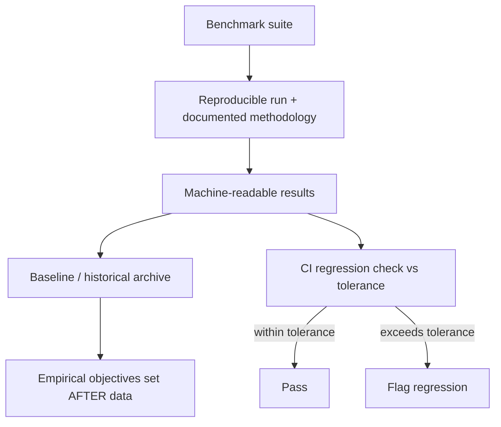

# ADR-014: Benchmarking

- **Status:** Accepted
- **Date: 2026-07-20**
- **Deciders: FlowShield maintainers**
- **Related:** ADR-002 (Core Architecture), ADR-006 (Redis Backend), ADR-005 (Storage Abstraction), ADR-012 (Observability); FR-060, NFR-001, NFR-003, NFR-004, NFR-035

## Context

FlowShield's value proposition is fast, correct traffic management on the request hot path. It is tempting to announce headline performance numbers early, but during the research phase (Phase 0) FlowShield has no implementation to measure. Numbers asserted before measurement are guesses that ossify into commitments and bias design toward premature optimization of the wrong things.

The core architecture (ADR-002) spans an in-memory path and network-backed stores (ADR-005, ADR-006), whose cost profiles differ by orders of magnitude. A credible performance story therefore requires a reproducible measurement apparatus before any target is set, so that objectives are derived from evidence rather than aspiration.

## Decision

**No numerical performance targets are set during the research phase.** FlowShield will not publish throughput, latency, or overhead targets until they are backed by empirical measurement. Official performance objectives are established only AFTER the benchmark suite yields data.

FlowShield will first build a **reproducible benchmark suite** covering the following scenarios:

| Scenario | What it measures |
|---|---|
| Throughput | Sustained decisions per second per limiter/algorithm |
| Latency (incl. tail) | Full distribution, p50 through p99.9, not just averages |
| Allocations | Heap allocations per decision on the hot path |
| Contention | Behavior under shared-state concurrency (lock/atomic pressure) |
| 10k concurrent requests | Behavior under high concurrent load |
| Redis round-trip overhead | Added cost of a network-backed store versus in-memory (ADR-006) |
| Multi-node scenario | Correctness and cost of distributed coordination across nodes |

**Reproducibility is mandatory.** Every benchmark documents its methodology: hardware/environment description, workload parameters, warmup and measurement windows, and statistical treatment. Runs emit **machine-readable output** so results can be diffed, archived, and compared over time rather than eyeballed from console logs.

**CI gates regressions.** Benchmarks run in CI and flag regressions that exceed a documented tolerance. The tolerance accounts for measurement noise so that normal environmental variance does not produce false alarms, while genuine regressions are surfaced before release.

## Alternatives Considered

- **Set aspirational targets now, validate later.** Rejected: unmeasured targets anchor design decisions to fiction and create commitments the project may not be able to honor.
- **Ad hoc, developer-local benchmarks only.** Rejected: not reproducible, not comparable across contributors or machines, and invisible to CI.
- **Average-latency-only measurement.** Rejected: tail latency governs real user experience under load; hiding the tail would misrepresent behavior.
- **In-memory benchmarks only.** Rejected: omits the network round-trip and multi-node coordination costs that dominate distributed deployments (ADR-005, ADR-006).
- **Manual regression review.** Rejected: does not scale, is inconsistent, and lets slow drift accumulate unnoticed; automated gating is required.

## Consequences

**Positive**
- Performance claims will be honest, evidence-based, and defensible.
- A shared, reproducible harness lets contributors compare changes objectively.
- Automated regression gating protects the hot path release over release.
- Machine-readable history enables trend analysis and informed objective-setting.

**Negative**
- Upfront investment in harness and CI infrastructure before headline numbers exist.
- CI runtime and maintenance cost; benchmark environments require stabilization to control noise.

**Neutral**
- Performance objectives are deferred deliverables, produced once data exists, not part of this ADR.
- Tolerance thresholds are living parameters, tuned as the measurement environment matures.

## Future Evolution

- Once data exists, a follow-up decision records official performance objectives per scenario.
- Add dedicated benchmark environments to reduce variance and tighten regression tolerances.
- Extend scenarios as new backends (e.g., Valkey) and algorithms land, keeping methodology consistent.
- Integrate benchmark signals with the observability signal set (ADR-012) for end-to-end performance narratives.
