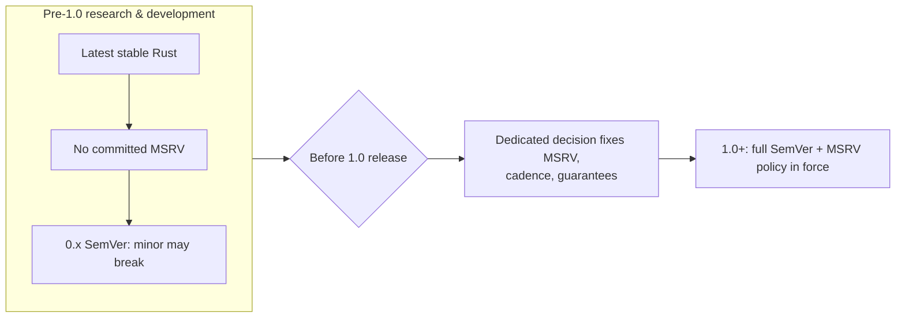

# ADR-015: Versioning, MSRV & Compatibility

- **Status:** Accepted (MSRV value deferred to pre-1.0)
- **Date: 2026-07-20**
- **Deciders: FlowShield maintainers**
- **Related:** ADR-013 (Extension API Stability), ADR-003 (Crate Structure), ADR-011 (Error Handling); NFR-030, NFR-031, NFR-032

## Context

FlowShield ships as a family of published crates under the `flowshield-` prefix (ADR-003). Consumers need predictable rules for how versions change, how long APIs remain stable, and which Rust compiler versions are supported. Committing to a Minimum Supported Rust Version (MSRV) too early, however, constrains development against a fast-moving language: FlowShield targets edition 2024 and requires modern Rust (>= 1.88 today), and the design still exercises recent language and standard-library capabilities. Freezing an MSRV during research would trade design freedom for a guarantee no consumer yet depends on.

The project therefore needs a versioning and compatibility policy that is firm on the parts consumers rely on (SemVer, deprecation discipline) while deliberately deferring the MSRV commitment until the API surface stabilizes.

## Decision

**Semantic Versioning.** All published FlowShield crates follow SemVer. Breaking changes to a stable public API require a major-version bump; backward-compatible additions bump the minor; fixes bump the patch. Pre-1.0, the SemVer convention that minor (`0.x`) releases may carry breaking changes applies, and this is communicated clearly.

**MSRV deferred.** No MSRV is committed during pre-1.0 research and development. FlowShield develops against the latest stable Rust. Before the first stable (1.0) release, a **dedicated decision** fixes:
- the MSRV value,
- the cadence for advancing it, and
- the compatibility guarantees tied to it (e.g., whether an MSRV bump is treated as a breaking change).

**Deprecation policy.** Removals are announced with a stated removal timeline; consumers get a transition window rather than a surprise break. Within a major version, stable public APIs keep working — deprecated items continue to function until their announced removal in a subsequent major release. Deprecations are surfaced in changelog and, where practical, via compiler-visible markers.

**Backward compatibility.** Within a major version, the stable public API is additive-only. The stability of public extension traits — the surfaces third parties implement or build upon — is governed specifically by ADR-013, which this ADR defers to for those guarantees.

## Alternatives Considered

- **Commit an MSRV now.** Rejected: prematurely constrains a design that exercises recent Rust features and offers no benefit to consumers who do not yet exist; the cost is paid in lost design freedom.
- **Never commit an MSRV.** Rejected: mature libraries owe downstream consumers a predictable compiler-support contract; deferral is a phase, not a permanent stance.
- **No formal deprecation policy.** Rejected: silent removals erode trust and break builds; announced timelines are a baseline expectation for published crates.
- **Independent, unsynchronized version numbers with no shared policy.** Rejected: a shared SemVer and compatibility discipline across the `flowshield-` family keeps cross-crate upgrades predictable.
- **Adopt a fixed "N most recent stable releases" MSRV window immediately.** Rejected: reasonable post-stabilization, but binding it now would again freeze the MSRV prematurely; it is a candidate for the dedicated pre-1.0 decision.

## Consequences

**Positive**
- Consumers get predictable, standards-based version semantics from day one.
- Development retains freedom to use modern Rust throughout research.
- Deprecation discipline gives downstreams a safe upgrade path.
- The MSRV commitment, when made, will be deliberate and informed by a stabilized API.

**Negative**
- Absence of a committed MSRV means early adopters must track latest stable Rust.
- The deferred MSRV decision is outstanding work that must complete before 1.0.

**Neutral**
- Pre-1.0 `0.x` releases may contain breaking changes by SemVer convention; this is expected during research.
- Extension-trait stability is intentionally out of scope here and owned by ADR-013.

## Future Evolution

- Execute the dedicated pre-1.0 MSRV decision: set the value, update cadence, and compatibility classification of MSRV bumps.
- Once at 1.0, tighten `0.x` breaking-change latitude into full stable SemVer guarantees.
- Document the deprecation timeline length as a concrete policy figure alongside the MSRV decision.
- Consider automated tooling (e.g., public-API diffing) to enforce SemVer and deprecation rules in CI.
