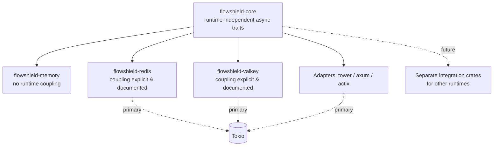

# ADR-016: Async Runtime Strategy

- **Status:** Accepted
- **Date: 2026-07-20**
- **Deciders: FlowShield maintainers**
- **Related:** ADR-002 (Core Architecture), ADR-005 (Storage Abstraction), ADR-006 (Redis Backend), ADR-003 (Crate Structure); NFR-051, NFR-021

## Context

FlowShield is async-first: rate-limit decisions frequently involve I/O to network-backed stores (ADR-005, ADR-006), and the framework must integrate with async web stacks (Tower, Axum, Actix). The Rust async ecosystem is not monolithic — Tokio is dominant but not universal, and many store client libraries are written against a specific runtime.

Two forces pull against each other. Committing the entire framework to one runtime maximizes ergonomics and lets FlowShield use that runtime's rich features, but excludes users on other runtimes and couples the pure decision logic to an executor it does not inherently need. Conversely, insisting on total runtime neutrality everywhere is impractical when backend client libraries are themselves runtime-bound. FlowShield needs a strategy that is pragmatic about where coupling is unavoidable and disciplined about keeping the core clean.

## Decision

**Tokio is the primary, officially-supported runtime.** It receives first-class support, documentation, and testing, and is the default assumption for FlowShield's integrations.

**The core stays runtime-independent as far as practical.** The core decision logic (ADR-002) is expressed through async traits and abstractions that avoid hard coupling to any specific executor. The pure algorithmic path does not spawn tasks on, or otherwise bind itself to, a particular runtime where that can be reasonably avoided.

**Backends may be runtime-coupled where their client libraries require it.** Store integrations (e.g., Redis, Valkey) depend on client libraries that may mandate a specific runtime. Where such coupling is unavoidable, it is **explicit and documented** at the crate boundary so consumers know exactly what a given backend crate pulls in — no hidden runtime dependencies.

**Additional runtimes come later via separate integration crates.** Rather than complicating the core with conditional multi-runtime support, alternative runtimes are added through dedicated integration crates in the `flowshield-` family (ADR-003), keeping each runtime's coupling isolated and opt-in.

## Alternatives Considered

- **Hard-couple the entire framework to Tokio, including the core.** Rejected: needlessly binds pure decision logic to an executor, foreclosing future runtime support and forcing the dependency on users who only need in-memory limiting.
- **Full runtime agnosticism everywhere, including backends.** Rejected: impractical because store client libraries are frequently runtime-bound; pursuing it would mean reimplementing clients or leaking abstraction complexity into every backend.
- **Support multiple runtimes inside the core via feature flags.** Rejected: multiplies the build/test matrix and entangles the core with executor-specific concerns; isolating runtimes in separate integration crates is cleaner and keeps coupling opt-in.
- **Pick a smaller/alternative runtime as primary.** Rejected: Tokio's ecosystem maturity and dominance among the target web stacks make it the pragmatic primary; alternatives remain reachable via integration crates.

## Consequences

**Positive**
- First-class Tokio experience for the majority of users and target web stacks.
- A clean, runtime-independent core preserves optionality and keeps pure logic portable.
- Runtime coupling is contained, explicit, and discoverable at crate boundaries.
- Future runtimes can be added without destabilizing the core.

**Negative**
- Non-Tokio users are not served until dedicated integration crates exist.
- Keeping the core runtime-independent constrains it from using Tokio-specific conveniences directly.

**Neutral**
- "As far as practical" is a judgment applied per component; some pragmatic coupling is accepted where unavoidable.
- Backend crates advertise their runtime dependency as part of their public contract.

## Future Evolution

- Add integration crates for alternative runtimes as demand and client-library support emerge.
- Document a compatibility matrix of backends versus runtimes as the ecosystem evolves.
- Revisit core abstractions if async trait ergonomics in Rust change materially.
- Coordinate runtime coupling disclosures with the feature-flag strategy so consumers can audit their dependency surface.
