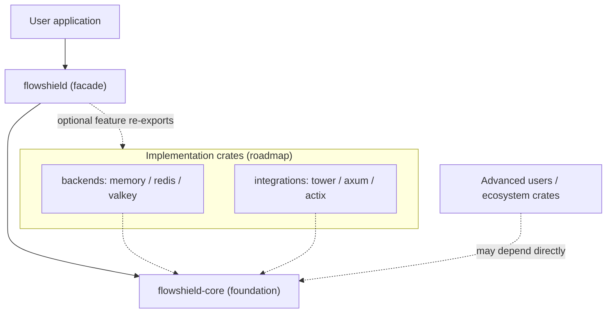

# ADR-018: Public Facade Crate (`flowshield`)

- **Status:** Accepted
- **Date:** 2026-07-20
- **Deciders:** FlowShield maintainers
- **Related:** ADR-002 (Core Architecture), ADR-003 (Crate Structure), ADR-004 (Public API), ADR-010 (Feature Flags), ADR-013 (Extension API Stability), ADR-015 (Versioning/MSRV); FR-003, NFR-021, NFR-023, NFR-040

## Context

`flowshield-core` has already been published to crates.io and must remain the foundation of the ecosystem — it will not be renamed, deprecated, or yanked. As the workspace grows into a multi-crate ecosystem (backends, framework integrations), we want the *user-facing* experience to be a single, ergonomic, stable crate rather than asking users to depend on `flowshield-core` and assemble pieces themselves.

The dominant Rust ecosystems solve this with a **facade over a core**: `tokio` over its internals, `tracing` over `tracing-core`, `futures` over `futures-core`, `tower` over `tower-service`/`tower-layer`. The facade is what most users install; the low-level crate(s) carry the contracts that the wider ecosystem builds on. We adopt that philosophy (not the specific code) as FlowShield's official direction.

## Decision

Introduce a new public crate **`flowshield`** as the primary entry point, sitting on top of `flowshield-core`.

**1. Roles.**
- **`flowshield`** — the ergonomic facade. Re-exports the curated, stable, user-facing API from `flowshield-core`; carries top-level documentation; and (as they land) hosts the user-facing feature flags that pull in backends and integrations. This is the crate promoted in documentation and installed by most users.
- **`flowshield-core`** — unchanged in purpose: algorithms, storage abstraction, extension traits, and internal logic. Remains published and supported. Advanced users and ecosystem crates may depend on it directly.

**2. Dependency direction.** Implementation crates (backends `flowshield-memory/redis/valkey`, integrations `flowshield-tower/axum/actix`) depend on **`flowshield-core`**, never on the facade. The facade depends on `flowshield-core` and, later, *optionally* re-exports the implementation crates behind feature flags. The graph stays acyclic; the core is the shared contract; the facade is a convenience layer. This refines ADR-003's "integrations and backends depend on core."

**3. Re-export policy.** The facade re-exports **only** the stable, user-facing API, via `#[doc(inline)] pub use`, so documentation reads as one coherent surface. Internal and extension APIs stay in `flowshield-core`. The **public compatibility contract is primarily the facade surface**; `flowshield-core`'s extension traits remain stable under ADR-013 for those depending on core directly.

**4. Feature flags host.** The user-facing feature taxonomy of ADR-010 (`memory`, `redis`, `valkey`, `tower`, `axum`, `actix`, `metrics`, `tracing`) is hosted on the **facade** and forwards to the implementation crates, giving a one-crate developer experience (`flowshield = { version = "…", features = ["redis", "axum"] }`). `flowshield-core` stays lean. These features are declared as their target crates land (declaring a feature that enables a non-existent optional dependency does not compile).

**5. Versioning.** `flowshield` and `flowshield-core` are versioned **independently** (as `tracing`/`tracing-core` are). The facade depends on `flowshield-core` with both a `version` (for crates.io) and a `path` (for the workspace). This lets core evolve its internal-facing surface at its own cadence while the facade presents the stable user contract (ADR-015).

## Alternatives Considered

- **Single crate (`flowshield-core` only, no facade).** Rejected: forces users onto the low-level crate, couples the user-facing API to internal structure, and offers no room to refactor core without churning users. Also loses the one-crate DX.
- **Rename `flowshield-core` to `flowshield`.** Rejected and impossible under the constraints: the core is already published and must not be renamed/yanked; renaming would break the existing crate and the ecosystem's foundation.
- **Facade re-exports everything, including internal/extension traits.** Rejected: it would make internals part of the user-facing SemVer contract and blur the stable surface. Extension traits stay in core, surfaced deliberately (ADR-013).
- **Feature flags hosted on `flowshield-core`.** Rejected: pushes backend/framework optional dependencies into the foundation crate, contradicting its lean, dependency-free role; the facade is the right aggregation point.

## Consequences

**Positive**
- A single, ergonomic, stable entry point (`use flowshield::…`) for the vast majority of users.
- Freedom to refactor `flowshield-core` internals without breaking users, as long as the facade's re-exports hold.
- Clear, acyclic dependency graph that scales as backends and integrations are added.
- The already-published `flowshield-core` is preserved as the foundation, exactly as required.

**Negative**
- Two crates to version, publish, and keep in sync; the facade's re-export layer is maintenance to curate.
- Possible version skew between facade and core; mitigated by a compatible `version` requirement and CI building the whole workspace together.
- Some documentation lives in two places (facade top-level docs vs. core API docs); mitigated by `#[doc(inline)]` and cross-links.

**Neutral**
- Advanced users choose their level: depend on `flowshield` for ergonomics, or on `flowshield-core` (and individual crates) for fine-grained control.

## Future Evolution

- As `flowshield-memory/redis/valkey` and `flowshield-tower/axum/actix` land, the facade gains the corresponding forwarding features (ADR-010) and `#[doc(inline)]` re-exports.
- Should a second high-level facade ever be warranted (e.g., a task-specific preset), it would follow the same rules; the core contract does not change.
- The re-export list is curated additively under ADR-013; removing a re-export is a breaking change to the facade and follows ADR-015.
