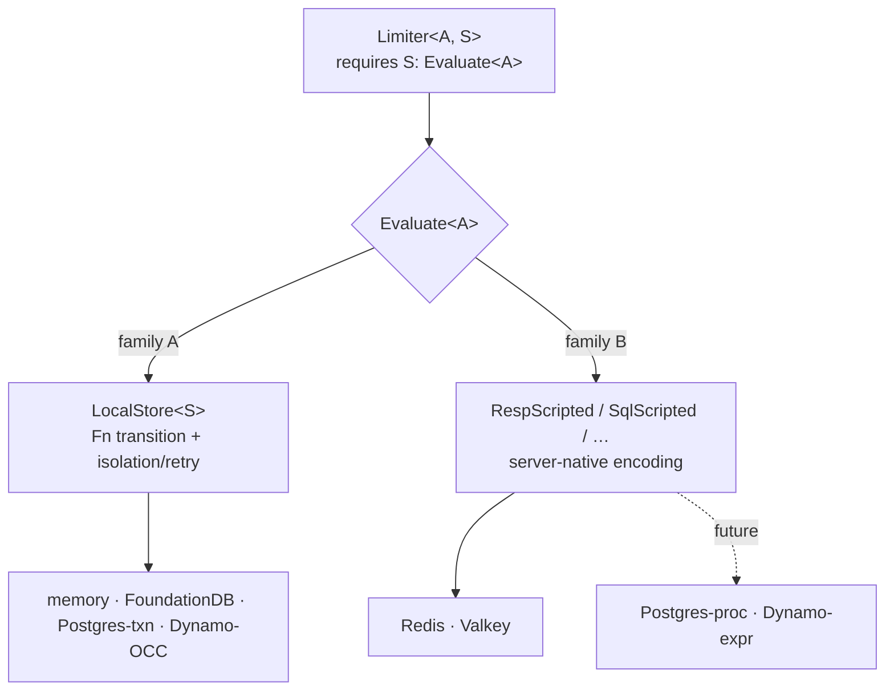

# ADR-019: Storage Seam Revision — Two Execution Families and the `Evaluate` Bridge

- **Status:** Accepted
- **Date:** 2026-07-21
- **Deciders:** FlowShield maintainers
- **Related:** ADR-002 (Core Architecture), ADR-005 (Storage Abstraction — *this ADR refines its Rust realization*), ADR-006 (Redis & Valkey Strategy), ADR-007 (Degradation), ADR-008 (Algorithms), ADR-013 (Extension API Stability), ADR-016 (Async Runtime), ADR-017 (Time Source); FR-021, FR-024, FR-025, NFR-002, NFR-020

## Context

Phases 1–2 shipped a single storage seam, `StorageBackend<S>`, whose atomic unit is a **client-side Rust closure**:

```rust
fn update(&self, key, now, ttl, step: impl FnOnce(Option<S>) -> (S, Decision) + Send) -> impl Future<…>;
```

This is a perfect fit for the in-memory backend: take a lock, run the closure under it, release. It is also the *only* shape the seam admits, and Phase 4 (Redis/Valkey) is the first backend to reveal that this shape does not reach a networked, server-atomic store.

**The core problem.** ADR-006 requires the check-and-consume to run atomically **on the server** (a Lua script), and prohibits client-side read-then-write as the correctness mechanism. But a Rust `FnOnce` closure cannot be shipped to a Redis server — Redis runs Lua, not Rust. So a Redis backend physically cannot satisfy `StorageBackend<S>` by invoking `step`. The seam was, in effect, designed around *client-side* atomicity.

A second force shapes the decision: the storage abstraction (ADR-005) must remain "agile to the majority of providers." The research-candidate backends named there — PostgreSQL, DynamoDB, FoundationDB — do **not** share an atomicity primitive with Redis or with each other:

| Backend | Atomicity mechanism | Can it run the Rust transition? |
|---|---|---|
| memory | in-process mutex | **Yes** — once |
| FoundationDB | ACID transaction, conflict-detect + **retry** | **Yes** — but may re-run on conflict |
| PostgreSQL | `SELECT … FOR UPDATE` in a txn, or a stored proc | **Yes** (txn) / No (stored proc) |
| DynamoDB | optimistic concurrency (read-version → compute → conditional write → **retry**), or `UpdateItem` expressions | **Yes** (OCC) / No (expressions) |
| Redis / Valkey | server-side Lua script | **No** |

The naive temptation is to invent a *single universal seam* that all of these execute natively. That is a mirage: there is no common transition language across Lua, SQL, DynamoDB expression syntax, and ACID-retry. Forcing one abstraction over all five collapses into "reimplement the algorithm once per backend language" or a leaky "portable transition IR" that no real database speaks.

## Decision

Model the storage seam as **two execution families**, unified for the limiter by a single bridge trait. Do **not** attempt a universal server-side transition primitive.

### Family A — client-side transition, backend-provided isolation (`LocalStore`)

The backend provides isolation (or transactional retry) around a **pure, re-runnable** Rust transition:

```rust
pub trait LocalStore<S: Send + 'static>: Send + Sync {
    fn transact(
        &self,
        key: &Key, now: Duration, ttl: Duration,
        step: impl Fn(Option<S>) -> (S, Decision) + Send,   // Fn, not FnOnce
    ) -> impl Future<Output = Result<Decision>> + Send;
}
```

The single change from the old seam that unlocks a whole class of backends: **`FnOnce` → `Fn`**. Because the algorithm transition is *pure* (ADR-008), a backend may run it **zero or more times** and commit the result of the final attempt. That is exactly what transactional/optimistic backends need to retry on conflict. Family A therefore covers memory (one call), FoundationDB (txn retry), PostgreSQL-in-transaction, and DynamoDB-with-OCC — with no per-algorithm server code.

### Family B — server-native transition (per-encoding capability traits)

Where the backend cannot run Rust, the **algorithm** supplies a backend-native encoding of its transition, gated behind a capability trait *specific to that encoding*:

```rust
pub trait RespScripted: Algorithm {
    /// The transition as it runs server-side on a RESP store (Lua + arg/result codec).
    fn resp_program(&self) -> RespProgram;
}
```

There is deliberately **no single "server transition" trait** — `RespScripted` (Lua) serves Redis/Valkey; a future `SqlScripted` serves PostgreSQL stored procs; a future `DynamoExpressed` serves DynamoDB. Each is additive (ADR-013). The Rust `Algorithm::step` remains the **reference oracle**: the conformance suite cross-checks that a family-B encoding produces decisions identical to `step` (ADR-005's determinism requirement).

### The bridge — `Evaluate<A>`, the limiter's sole seam

The limiter depends on neither family directly, but on one bridge trait meaning *"store `S` can evaluate algorithm `A`"*:

```rust
pub trait Evaluate<A: Algorithm>: Send + Sync {
    fn evaluate(&self, algo: &A, key: &Key, now: Duration, ttl: Duration, cost: u64)
        -> impl Future<Output = Result<Decision>> + Send;
    fn kind(&self) -> &'static str { "unknown" }   // low-cardinality telemetry label (ADR-012)
}
```

- **Family A** satisfies it via a shared helper, `evaluate_local`, that builds the pure closure and drives `transact`. Each family-A store writes a small, uniform `Evaluate` impl that forwards to the helper.
- **Family B** (e.g. Redis) implements `Evaluate<A>` **directly** for `A: RespScripted`, running the server program.

`Limiter<A, S, C>` requires only `S: Evaluate<A>`. Adding any future backend is then additive: implement `LocalStore` (family A — nothing new in core) or add an encoding capability + an `Evaluate` impl (family B). **The core seam is never rewritten again.**

#### Why a bridge trait rather than a blanket impl

A blanket `impl<A, T: LocalStore<A::State>> Evaluate<A> for T` is tempting but **incoherent**: Rust cannot prove a concrete family-B store (e.g. `RedisStore`) does *not* also implement `LocalStore`, so the blanket would conflict with `impl<A: RespScripted> Evaluate<A> for RedisStore`. Instead, each family-A store carries its own thin `Evaluate` impl (self type is the concrete store, e.g. `MemoryStore<A::State>`, keeping the type parameter constrained by the trait reference and coherent against family-B impls). The `evaluate_local` helper keeps that impl to a few lines.



## Alternatives Considered

- **Keep `StorageBackend<S>` (closure only).** Rejected: cannot express server-side atomicity; Redis would be forced into prohibited client-side read-then-write (ADR-006).
- **One universal server-transition primitive all backends execute.** Rejected: no common language exists across Lua/SQL/Dynamo-expressions/ACID-retry; it degenerates into N reimplementations or a fictional portable IR.
- **Bake Lua for Token Bucket + GCRA into the Redis backend, no algorithm capability.** Rejected: the backend stops being algorithm-generic, third-party algorithms cannot go distributed, and the transition is duplicated away from the algorithm that owns it (against ADR-002).
- **Blanket `Evaluate` impl for all `LocalStore`.** Rejected: coherence conflict with concrete family-B impls (see above).
- **Wrapper newtype `Local<T>` to host the family-A `Evaluate` impl.** Viable and coherent, but taxes *user* ergonomics (`Local(store)` at every call site). Rejected in favor of a per-store impl + shared helper, which keeps the user-facing builder clean; few backends pay the small boilerplate, many users get the clean API.

## Consequences

**Positive**
- One bridge (`Evaluate<A>`) is all the limiter and composite layer know; both families plug in behind it.
- The `Fn` transition makes transactional/optimistic backends (FDB, Postgres, Dynamo-OCC) fit family A with **no server code**.
- Family B stays honest and per-encoding; server-native support is additive, never a core rewrite.
- The Rust `step` becomes a cross-implementation oracle, strengthening the conformance story (ADR-005 determinism).

**Negative**
- Breaking change to the published `flowshield-core` seam → **0.1 → 0.2** minor bump (permitted under `0.x` SemVer, ADR-015). `StorageBackend` is renamed/replaced.
- Two traits instead of one; family-A backends write a small `Evaluate` forwarding impl.
- The conformance harness must relax its "step invoked exactly once" assertion to "at least once" to admit retrying backends (retry-aware cross-checks arrive with the first such backend).

**Neutral**
- No distributed code lands in this revision. Redis/Valkey (`RespScripted` + `RedisStore: Evaluate`) build on the approved seam in Phase 4 proper.
- Research-candidate backends (PostgreSQL, DynamoDB, FoundationDB) remain deferred beyond 1.0; the seam is left *open* to them, not built for them.

## Future Evolution

- Phase 4 adds `RespScripted` with a real Lua `RespProgram` + codec, `flowshield-redis`/`flowshield-valkey` implementing `Evaluate` directly, and a conformance cross-check of Lua vs `step`.
- Post-1.0 backends add their own family-A impls or family-B encoding capabilities without touching the bridge.
- If a future algorithm needs atomic multi-key semantics, the bridge can gain a capability-gated sibling under ADR-013, exactly as ADR-005 anticipated.
