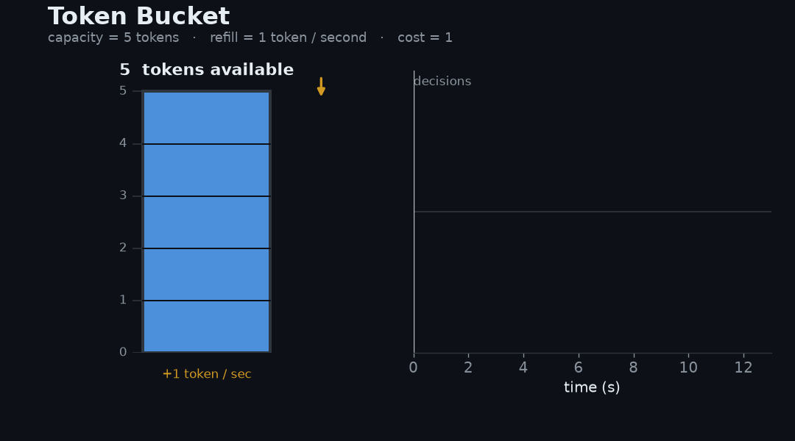
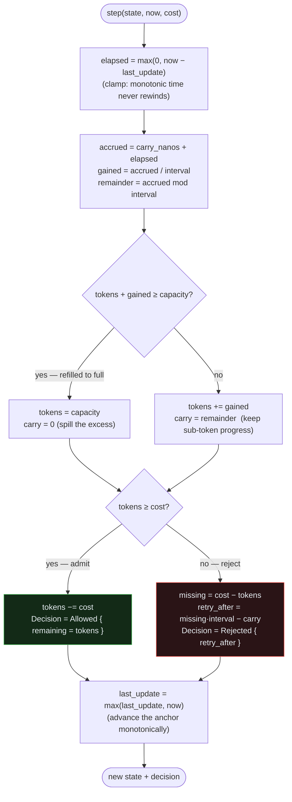
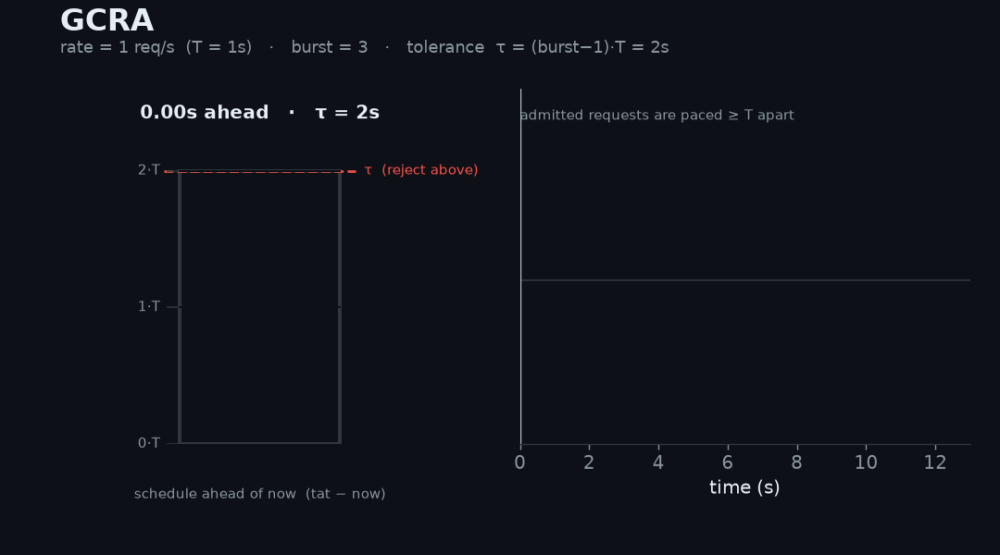
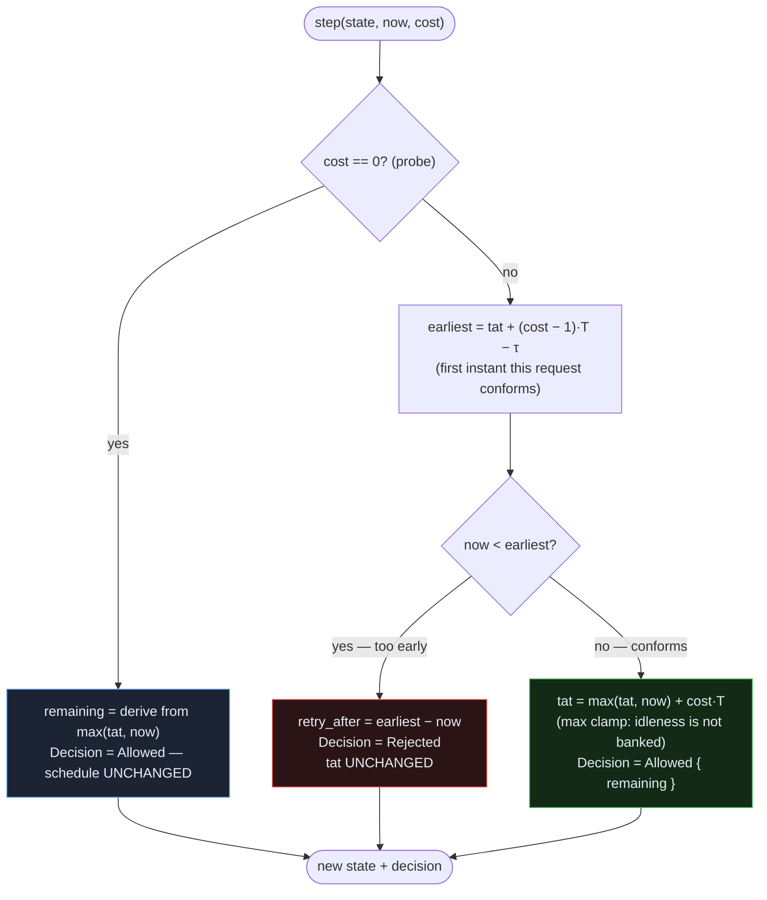

# FlowShield — The Rate-Limiting Algorithms

This document explains the two algorithms FlowShield ships in v1 — **Token Bucket** (the default) and **GCRA** — from first principles: the mental model, the exact per-key state, a worked example, the decision flow, and the edge cases the implementation deliberately handles. It is the companion reading for the code in [`crates/flowshield-core/src/algorithm/`](../../crates/flowshield-core/src/algorithm/) and the *why* recorded in [ADR-008](../adr/ADR-008-algorithms.md).

> **The one contract both algorithms obey.** An `Algorithm` is a **pure state machine**. Its only method is
> ```rust
> fn step(&self, state: State, now: Duration, cost: u64) -> (State, Decision)
> ```
> No clock is read inside `step`; `now` is injected by the limiter from the monotonic [`TimeSource`](../adr/ADR-017-time-source.md). No I/O happens; storage is the caller's job. Given the same `(state, now, cost)`, `step` always returns the same `(state, decision)` — which is what makes decisions reproducible across backends and trivially unit-testable. Both algorithms below are just two different ways of computing that one function. See [`algorithm/mod.rs`](../../crates/flowshield-core/src/algorithm/mod.rs).

Every admission ends in a [`Decision`](../../crates/flowshield-core/src/decision.rs): `Allowed { remaining }` or `Rejected { retry_after }`, where `retry_after` is always a **relative** duration, never a wall-clock timestamp.

---

## 1. Token Bucket — the intuitive default

**Mental model.** Picture a bucket that holds up to `capacity` tokens. It refills at a steady **one token per `refill_interval`**. Every request of cost *n* must pay *n* tokens up front: if the bucket holds enough, the request is admitted and the tokens are removed; if not, it is rejected together with the time until enough tokens will have accrued. A fresh or long-idle key starts **full**, so it can absorb an immediate burst of up to `capacity` requests before the steady refill rate takes over.

This is the model most engineers already carry in their heads from API gateways and cloud rate limiters (`rate` + `burst`), which is exactly why it is FlowShield's default (ADR-008).



*The bucket starts full at 5. A burst of 5 requests drains it to empty and each is admitted; the 6th finds an empty bucket and is rejected with a `retry_after`. The bucket then refills one token per second (each paced request finds exactly one waiting). After a long idle stretch it refills only up to the cap of 5 — idleness is never banked beyond `capacity` — and the next burst is admitted.*

### State: three integers, zero floating-point drift

```rust
struct TokenBucketState {
    tokens: u64,        // whole tokens available, 0..=capacity
    carry_nanos: u64,   // sub-token progress toward the next token, 0..interval
    last_update: Duration, // the anchor elapsed time is measured from
}
```

The subtle part is `carry_nanos`. A naïve token bucket tracks a *fractional* token count in `f64` and accumulates rounding error over millions of steps. FlowShield instead keeps refill in **exact integer nanoseconds**: elapsed time plus the carried remainder is divided by the interval to yield *whole* tokens gained, and the leftover nanoseconds are carried into the next call. The only floating-point operation in the whole algorithm is a one-time conversion of a rate into an interval at construction. Decisions are therefore **bit-reproducible** across runs and machines. See the module docs and [`token_bucket.rs`](../../crates/flowshield-core/src/algorithm/token_bucket.rs).

### Worked example

`capacity = 2`, `refill_interval = 1s`, all requests cost 1:

| now | before | refill | after refill | request | decision | after |
|----:|-------:|-------:|-------------:|:--------|:---------|------:|
| 0.0s | 2 | +0 | 2 | cost 1 | **Allowed**, remaining 1 | 1 |
| 0.0s | 1 | +0 | 1 | cost 1 | **Allowed**, remaining 0 | 0 |
| 0.0s | 0 | +0 | 0 | cost 1 | **Rejected**, retry 1.0s | 0 |
| 0.4s | 0 | +0 (0.4s carried) | 0 | cost 1 | **Rejected**, retry 0.6s | 0 |
| 1.0s | 0 | +1 (0.4s carry + 0.6s) | 1 | cost 1 | **Allowed**, remaining 0 | 0 |

Notice row 4 → row 5: the 0.4s that produced no whole token was *remembered* in `carry_nanos`, so the token lands at exactly 1.0s, not 1.4s. This is the invariant the `carry_is_exact_across_many_sub_interval_steps` and `partial_interval_accrues_no_token_but_is_remembered` tests pin down.

### Decision flow



### Properties (ADR-008)

- **Burst behaviour:** allows bursts up to `capacity`, then the average one-per-`refill_interval` rate.
- **Smoothing:** *moderate* — bursty while tokens remain, smooth once drained.
- **Memory per key:** low — two integers plus a timestamp.
- **Distributed suitability:** strong — the transition is an atomic update of small state.

### Edge cases the code handles on purpose

- **Refill caps at `capacity`.** Overflow tokens *and* any fractional progress toward a further token are discarded when the bucket refills to full — an idle key cannot bank unbounded credit (`idle_refill_caps_at_capacity`).
- **Backwards `now` never mints tokens.** Under concurrency the limiter samples `now` outside the store's atomic section, so a stale sample can arrive after a newer one. `elapsed` clamps to zero and `last_update` is advanced with `max`, so a reordered call cannot re-count elapsed time (`backwards_time_never_grants_tokens`, and the ADR-017 addendum).
- **`cost > capacity` is unsatisfiable.** The returned `retry_after` will elapse but the request still can't be paid — classic token-bucket semantics, and the caller's contract.

---

## 2. GCRA — the precise, smoothly-paced alternative

**Mental model.** GCRA (the Generic Cell Rate Algorithm) does not count tokens. It tracks a single instant, the **theoretical arrival time** (`tat`): the moment the *next* request would land if the caller were perfectly paced at the sustained rate. Two constants shape it, both fixed at construction:

- **Emission interval** `T = 1 / rate` — the spacing between requests at steady state.
- **Burst tolerance** `τ = (burst − 1)·T` — how far *ahead* of the schedule a caller may run.

A request of cost *n* at time `now` **conforms** when `now ≥ tat + (n − 1)·T − τ`. If it conforms, the schedule advances to `max(tat, now) + n·T`; if not, the state is left untouched and the caller is told how long to wait. Because an idle key has `tat ≤ now`, the `max(tat, now)` clamp means idleness is never banked beyond `τ`.

**The key insight — GCRA is the token bucket turned inside out.** Where the token bucket measures *how many tokens remain* (draining toward 0), GCRA measures *how far the schedule runs into the future* (`tat − now`, filling toward the `τ` ceiling). They are mirror images: "0 tokens left" is the same state as "`τ` seconds ahead of schedule." The animation below deliberately draws GCRA as a gauge filling toward `τ`, so you can hold it next to the token bucket draining toward empty.



*`rate = 1/s` (so `T = 1s`), `burst = 3` (so `τ = 2s`). A cold key admits a burst of 3 at once — then the schedule is `τ` ahead and the next request is rejected with a short `retry_after`. Thereafter admissions are paced exactly one per `T`: notice the admitted-request ticks on the right land evenly ≥ `T` apart, which is GCRA's whole point. After a long idle stretch the key again admits only `burst` requests back-to-back — the `max(tat, now)` clamp caps banked credit at `τ`.*

### State: one value

```rust
struct GcraState { tat: Duration }   // theoretical arrival time
```

That is the entire per-key footprint — a single `Duration`. All schedule arithmetic is exact integer nanoseconds; the only floating-point step is the `rate → T` conversion at construction. See [`gcra.rs`](../../crates/flowshield-core/src/algorithm/gcra.rs).

`remaining` (how many further cost-1 requests would be admitted right now) is **derived** from the schedule, not stored: `(τ − (tat − now)) / T + 1`, clamped to zero once the schedule is more than `τ` ahead. It mirrors the token bucket's `remaining` so the two algorithms present a uniform `Allowed { remaining }`.

### Worked example

`rate = 1/s` (`T = 1s`), `burst = 3` (`τ = 2s`), cold key so `tat = now = 0`, all requests cost 1. A request conforms when `now ≥ tat − τ`:

| now | tat (before) | earliest = tat − τ | conforms? | decision | tat (after) |
|----:|-------------:|-------------------:|:----------|:---------|------------:|
| 0.0s | 0.0s | −2.0s | yes | **Allowed**, remaining 2 | 1.0s |
| 0.0s | 1.0s | −1.0s | yes | **Allowed**, remaining 1 | 2.0s |
| 0.0s | 2.0s | 0.0s | yes | **Allowed**, remaining 0 | 3.0s |
| 0.0s | 3.0s | 1.0s | **no** | **Rejected**, retry 1.0s | 3.0s *(unchanged)* |
| 1.0s | 3.0s | 1.0s | yes | **Allowed**, remaining 0 | 4.0s |

Three requests admit instantly on the cold key (the burst), the fourth is paced out, and exactly one admit becomes available per second thereafter. This is the `cold_key_admits_full_burst_then_rejects` and `admits_one_per_emission_interval_after_burst` behaviour.

### Decision flow



### Properties (ADR-008)

- **Burst behaviour:** bounded — up to `burst` requests may arrive together on a cold key; thereafter admission is paced at one per `T`.
- **Smoothing:** *high* — enforced inter-arrival spacing yields even pacing, so no caller can monopolise a shared resource by bursting.
- **Memory per key:** minimal — a single `Duration`.
- **Distributed suitability:** strong — the transition is an atomic update of one value.

### Edge cases the code handles on purpose

- **Idle credit is capped at `τ`.** No matter how long a key stays quiet, at most `burst` requests admit back-to-back — the `max(tat, now)` clamp (`idle_key_does_not_bank_unbounded_credit`).
- **A zero-cost probe never moves the schedule.** `cost == 0` reports current headroom and returns the state untouched — useful for "how many do I have left?" checks without consuming (`zero_cost_probe_is_allowed_without_advancing`).
- **`retry_after` shrinks as time passes.** A rejected request re-evaluated later reports a smaller wait, because `earliest − now` shrinks with `now` (`retry_after_shrinks_as_time_passes`).

---

## 3. Choosing between them

Both are O(1) in time and tiny in state, and both compose with any backend through the same atomic check-and-consume contract (ADR-005). The difference is entirely in *burst shape and fairness*:

| | **Token Bucket** (default) | **GCRA** |
|---|---|---|
| What it tracks | tokens remaining (drains to 0) | schedule ahead of now (fills to τ) |
| Burst | up to `capacity` at once | up to `burst` at once |
| After the burst | average one-per-interval | **evenly paced**, one per `T` |
| Fairness in the moment | moderate — one caller can spend a full burst instantly | high — enforced spacing stops any caller monopolising |
| Mental model | familiar (gateways, cloud) | precise (schedule/pacing) |
| Per-key state | `tokens`, `carry`, `last_update` | `tat` |

**Rule of thumb:** keep the **Token Bucket** default when you want the familiar, burst-friendly behaviour engineers expect. Reach for **GCRA** when you are protecting a sensitive shared downstream whose fairness depends on *when* requests land, not merely how many land per second — GCRA's even pacing prevents one bursty caller from starving the rest. The full rationale, including why the other classic algorithms are deferred, is in [ADR-008](../adr/ADR-008-algorithms.md).

---

## References

- Code: [`algorithm/token_bucket.rs`](../../crates/flowshield-core/src/algorithm/token_bucket.rs), [`algorithm/gcra.rs`](../../crates/flowshield-core/src/algorithm/gcra.rs), [`algorithm/mod.rs`](../../crates/flowshield-core/src/algorithm/mod.rs)
- Decision type: [`decision.rs`](../../crates/flowshield-core/src/decision.rs)
- Decisions: [ADR-008 Algorithms](../adr/ADR-008-algorithms.md), [ADR-005 Storage Abstraction](../adr/ADR-005-storage-abstraction.md), [ADR-017 Time Source](../adr/ADR-017-time-source.md)
- Diagram sources: [`../diagrams/token-bucket-flow.mmd`](../diagrams/token-bucket-flow.mmd), [`../diagrams/gcra-flow.mmd`](../diagrams/gcra-flow.mmd); animations in [`../diagrams/animations/`](../diagrams/animations/README.md)
