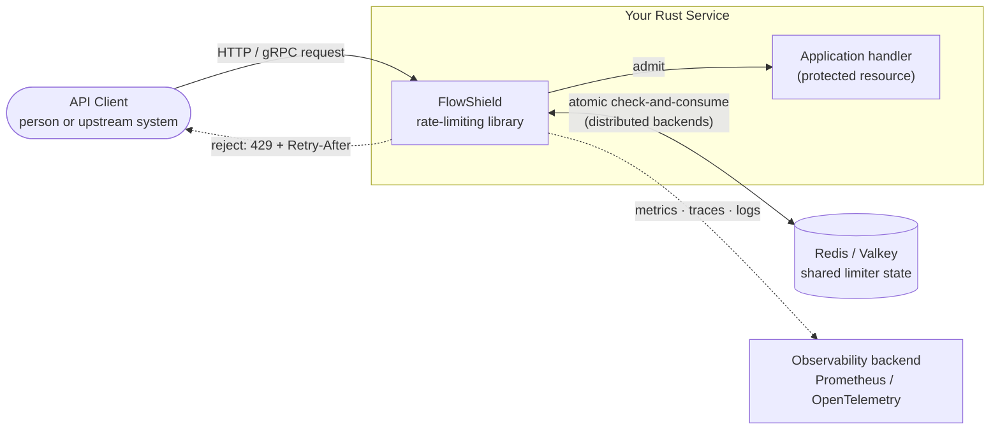
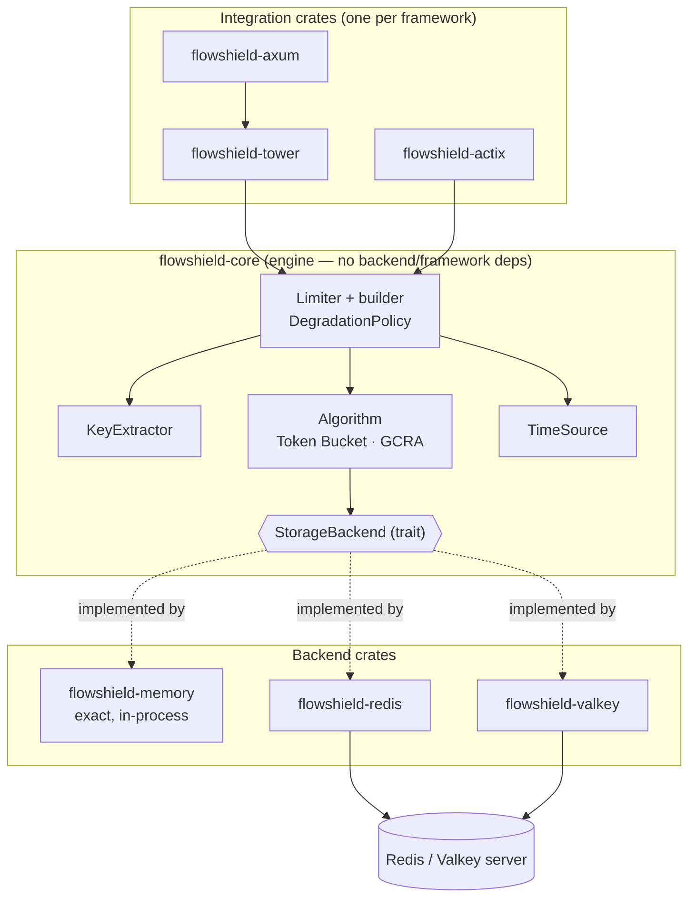
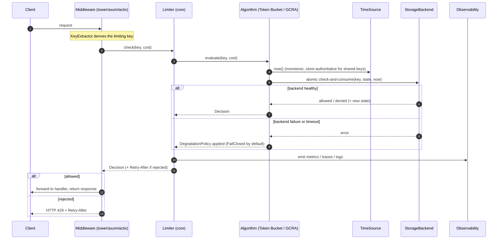

# FlowShield — Architecture Overview

This document is the narrative map of FlowShield's architecture. It presents the system at three zoom levels — **context**, **containers/crates**, and the **request lifecycle** — and links each to the decisions that justify it. The decisions themselves live in the [ADRs](../adr/README.md); the diagram sources live in [`../diagrams/`](../diagrams/README.md) as `.mmd` files (the copies below are rendered from those sources).

> Scope note: this describes the *designed* system. FlowShield is in Phase 0; no production code exists yet. This overview is the target the implementation will realize.

---

## 1. System context (C4 Level 1)

FlowShield is a **library embedded in your Rust service**, not a standalone appliance (ADR-001). It sits on the request hot path: it derives a key for each incoming request, decides whether to admit it, and either forwards it to your handler or rejects it with an HTTP 429 and a `Retry-After`. For distributed limiting it coordinates through a shared store (Redis/Valkey); it emits telemetry to your observability stack.

**What this establishes:** FlowShield consumes a caller-supplied identity (it does not authenticate — ADR-001, NG-08), composes *into* services and gateways rather than being one (NG-01), and treats the shared store as the coordination point for cross-node limits (ADR-006).

---

## 2. Containers / crates (C4 Level 2)

FlowShield is a multi-crate workspace with a strict **inward dependency rule**: integrations depend on the core, backends implement a core trait, and the core depends on neither (ADR-003, ADR-002). A user pays — in dependencies, compile time, and binary size — only for the backend and integration they enable (ADR-010).

**Roles:**

| Element | Responsibility | Governing ADR |
|---------|----------------|---------------|
| `flowshield-core` | The engine and the public contract; storage- and framework-agnostic. | ADR-002 |
| `KeyExtractor` | Derives the limiting key from a request/context (extension point). | ADR-004, ADR-013 |
| `Algorithm` | The decision strategy — Token Bucket (default) or GCRA (extension point). | ADR-008 |
| `StorageBackend` | Holds per-key state; provides atomic check-and-consume (extension point). | ADR-005 |
| `TimeSource` | Injectable monotonic clock; store-authoritative for shared keys. | ADR-017 |
| `Limiter` + builder | Composes the above; owns the `DegradationPolicy`; validates config. | ADR-004, ADR-007 |
| Backend crates | Concrete stores: exact in-memory; RESP-based Redis/Valkey. | ADR-006 |
| Integration crates | Thin per-framework adapters; isolated from one another. | ADR-009 |

The four extension points (`StorageBackend`, `Algorithm`, `KeyExtractor`, integration middleware) are public and **not sealed**, evolving additively under SemVer — this is what makes FlowShield an ecosystem rather than a closed library (ADR-013).

---

## 3. Request lifecycle

A single admission decision threads through key extraction, the algorithm, the time source, and the storage backend, then folds in the degradation policy and observability before returning.

**The load-bearing details:**

- **Atomicity lives with the state.** The check-and-consume is a single indivisible operation on the node holding the state — in-process for memory, server-side scripting for RESP backends — so concurrent requests on one key cannot race past the limit (ADR-005, ADR-006).
- **Time is monotonic and injectable.** Algorithms read elapsed time through `TimeSource`, never a wall clock; shared-key decisions use store-authoritative time so inter-node skew is not a correctness variable; tests drive a controllable clock (ADR-017).
- **"Rejected" ≠ "failed".** A rejection is a normal `Decision` carrying `Retry-After`; a backend error is a distinct outcome routed to the `DegradationPolicy`, which defaults to **FailClosed** and is bounded by a mandatory timeout (ADR-007, ADR-011).
- **Observability is on the path but off by default.** Metrics/traces/logs are feature-gated with negligible overhead when disabled, and never emit sensitive key material by default (ADR-012).

---

## 4. Consistency & correctness posture

FlowShield distinguishes **node-level operation semantics** from **deployment-topology behavior** (ADR-005): a Redis/Valkey check-and-consume is *exact on the executing primary*; bounded over-admission arises only from replication/failover topologies, and is documented per backend. The memory backend is exact in-process. Research-candidate backends (PostgreSQL, DynamoDB, FoundationDB) carry no guarantee until designed. Determinism — identical inputs and conditions yielding identical logical decisions within a backend's guarantee — is enforced by the backend conformance suite (ADR-005, FR-025), which relies on the injectable time source (ADR-017).

---

## 5. Where to go next

- **Decisions:** [ADR index](../adr/README.md) — the *why* behind every element above.
- **Requirements:** [`../design/Requirements.md`](../design/Requirements.md) — the FR/NFR these diagrams satisfy.
- **Roadmap:** [`../design/Plan.md`](../design/Plan.md) — the phase that builds each piece.
- **Diagram sources:** [`../diagrams/`](../diagrams/README.md) — edit the `.mmd` files, then update the rendered copies here.
